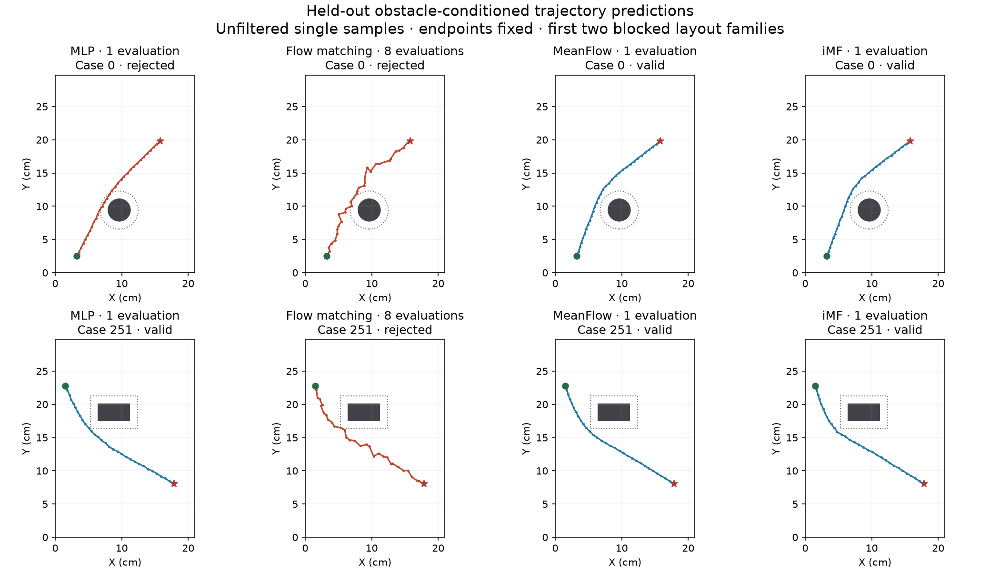
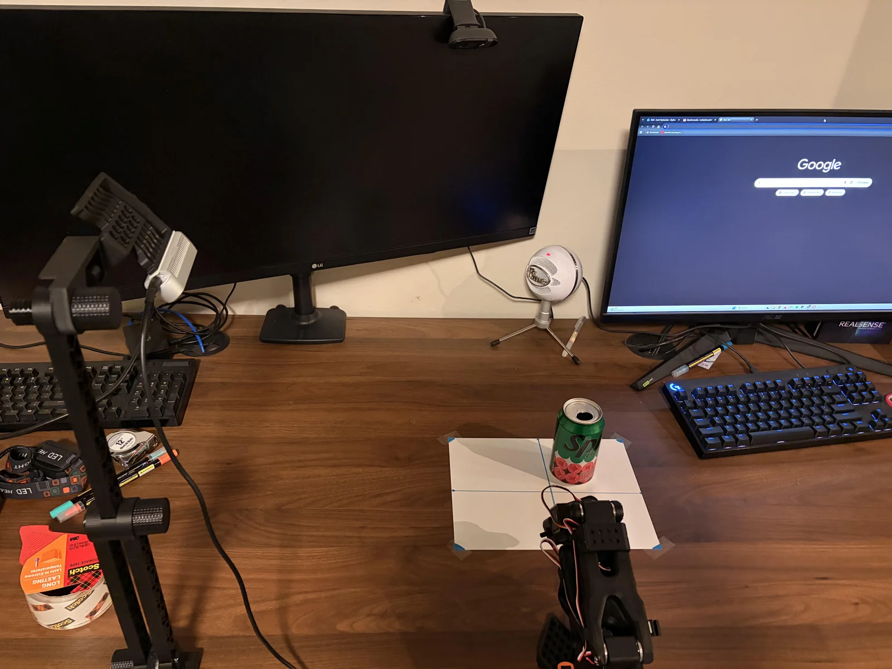

# DeskBuddy

[](https://github.com/AmirRoshankar/DeskBuddy/actions/workflows/tests.yml)


**One-step flow matching for robot motion planning.**

DeskBuddy compares learned trajectory proposals with classical planning, then connects them to an SO-101 arm through vision, numerical IK and feedback control. The real-robot demo picks up a soda can, moves it to a selected discard area and releases it.

## Demo

[](https://raw.githubusercontent.com/AmirRoshankar/DeskBuddy/main/docs/assets/success.mp4)

- **Question:** can a one-step Improved MeanFlow planner propose collision-free paths fast enough for closed-loop use?
- **Result:** on 500 held-out planning problems, iMF produced a valid path **86.2%** of the time versus **69.2%** for an MLP; on blocked direct routes, **72.7% versus 37.6%**. Four iMF candidates reached **97.6%**.
- **Limit:** the harder full-arm experiment solved **0 of 31** blocked cases with iMF.
- **Open problem:** incorporating new observations while a trajectory is already executing.

[Full physical demo · MP4 · 100 seconds](https://raw.githubusercontent.com/AmirRoshankar/DeskBuddy/main/docs/assets/success.mp4). The preview runs at 3x speed.

## Main result



| Planner | Valid path | Valid with direct route blocked | Median total planning, ms |
| --- | ---: | ---: | ---: |
| RRT-Connect | 100.0% | 100.0% | 1.18 |
| MLP | 69.2% | 37.6% | 0.84 |
| FM · 8 evaluations | 73.4% | 47.8% | 0.85 |
| MF · 1 evaluation | 81.8% | 62.9% | 0.54 |
| iMF · 1 evaluation | 86.2% | 72.7% | 0.53 |

These are tool-proxy paths: validity checks every segment against inflated 2D obstacles before fallback. All rows use the same 500 problems, including 245 blocked routes, from 20 held-out layout families. CPU timings include generation, checking and RRT fallback; they exclude perception and robot execution.

**Statistics:** iMF exceeded MF by **4.4 percentage points**, with a **95% layout-family bootstrap interval of 2.8–6.2** for the fixed checkpoints. In three fresh training runs, one-candidate iMF averaged **85.3% ± 0.2 pp**, versus **69.3% ± 0.8 pp** for MLP; four-candidate iMF averaged **97.7% ± 0.1 pp**. The ± values are sample standard deviations across seeds.

[Full comparison](docs/research/planner-comparison.md) · [Three-seed study](docs/research/training-seeds.md) · [Model formulations](docs/research/model-formulation-audit.md)

## What I built

- **A robot that clears a can from the workspace.** Detection, grasping, pickup checks, transfer, discard and retries share one task pipeline.
- **A way to compare learned and classical paths.** Direct, MLP, iMF and RRT previews use the same live scene; numerical IK and whole-arm checks connect proposals to the arm.
- **A 3D view of what the robot thinks is there.** Select targets, drag workspace bounds and inspect the arm, objects and planned paths alongside both cameras.
- **Corrections based on what the arm actually does.** Encoder feedback, Kalman state estimation and webcam tracking support bounded execution corrections. Local XY probes estimate an image Jacobian for fine alignment.
- **Experiments that can be rerun without hardware.** Shared datasets, held-out families, training seeds and MuJoCo gravity/contact experiments separate geometric, simulation and physical results.

## Setup



**Photo key:** SO-101 arm in the foreground; Logitech Brio above the monitor; RealSense D435 on the left mount; A4 workspace with blue reference marks around the can. The discard zone is selected in the UI rather than marked on the desk.

## Reproduce the main result

After installing the project with `python -m pip install -e ".[flow]"`:

```bash
python scripts/build_planner_comparison.py --reproduce
```

Downloads checksummed checkpoints and synthetic data when needed, reruns the 500-condition CPU benchmark, and rebuilds the table and bootstrap in `runs/deskbuddy/reproduction/`. No cameras or motors are used. [Inputs, versions and training commands](docs/research/reproducibility.md).

## Run the app

```bash
python -m venv .venv
# Activate .venv, then:
python -m pip install -e ".[dev]"
python -m deskbuddy demo --headless --output runs/offline
python -m deskbuddy demo
```

**Windows** is the primary hardware UI platform; double-click **Start DeskBuddy.cmd** after local setup. **Linux** supports offline experiments and the Tk desktop preview; CI runs under Xvfb. Camera drivers and hardware setup are documented separately. Python 3.12+ is required. macOS has not been tested.

Optional extras: `[flow,viz]` for learning/plots, `[simulation]` for MuJoCo, and `[camera,robot,perception]` for hardware. See [installation](docs/guides/installation.md).

**Hardware:** clamp the base, keep the workspace clear and support the arm before pressing Disable, which releases torque.

## Open problems

- **Plans go stale when objects move.** Scene relocation handling and [continuous-replanning tests](tests/test_continuous_replan.py) are in place; incorporating new evidence smoothly, rather than repeatedly restarting, remains the research goal.
- **Whole-arm constraints change the problem.** iMF solved 0/31 blocked cases in the joint-space experiment. Conditioning on body geometry and improving difficult-route coverage are next steps.
- **Grasp simulation still has a transfer gap.** The physics-trained checkpoint completed 6/246 simulated pick-and-drops versus 3/246 for the geometric checkpoint. Better contact models and outcome feedback are needed.
- **Pickup verification has no force sensor.** Visual evidence can be ambiguous under occlusion, can rotation or reflections.

## Development history

I developed DeskBuddy locally in November 2026 and published the initial release on **November 26, 2026**. The early work arrived in one release commit; subsequent improvements have their actual commit dates.

| Date | Milestone | Evidence |
| --- | --- | --- |
| Nov 24 | Click-to-Reach: camera/arm calibration and first physical IK reach | [Calibration report](docs/research/results/calibration_results.json), [first reach](docs/research/results/first_reach_results.json) |
| Nov 25 | FlowReach: flow-matching experiments and the planner comparison | [Trajectory plot](docs/assets/trajectory-learning.png), [metrics](docs/research/results/trajectory-learning.json) |
| Nov 26 | FlowDesk: multi-camera workspace, grasping and physics experiments | [Controller view](docs/assets/success-poster.jpg), [MuJoCo experiment](docs/guides/can-physics-and-retries.md) |
| Nov 26 | DeskBuddy: first public release and recorded can pickup/discard | [Release](https://github.com/AmirRoshankar/DeskBuddy/releases/tag/v0.1.0), [physical demo](docs/assets/success.mp4) |
| Nov 27 | Reproduction command, three-seed study and research documentation | [Seed results](docs/research/training-seeds.md), [reproduction guide](docs/research/reproducibility.md) |

Click-to-Reach, FlowReach and FlowDesk were names used during development, not separate projects. New artifacts use `runs/deskbuddy/`; older experiment records retain their original names. I used AI coding tools for implementation, debugging and tests.

## References and learning resources

[MeanFlow](https://arxiv.org/abs/2505.13447) · [Improved MeanFlow](https://arxiv.org/abs/2512.02012) · [Adaptive Mean Flow](https://arxiv.org/abs/2610.06089) · [Lie-group MeanFlow grasping](https://arxiv.org/abs/2608.26076) · [SORT](https://arxiv.org/abs/1602.00763) · [YOLOE](https://arxiv.org/abs/2503.07465) · [OMPL](https://ompl.kavrakilab.org/) · [LeRobot](https://github.com/huggingface/lerobot) · [MuJoCo](https://github.com/google-deepmind/mujoco) · [MIT 6.8210](https://underactuated.csail.mit.edu/)

[How these resources relate to the code](docs/research/references.md) · [Documentation](docs/README.md) · [Development guide](docs/MAINTAINER.md)

## Development

```bash
python -m pip install -e ".[dev,flow,simulation]" opencv-python
python -m ruff check src tests scripts
python -m ruff format --check src tests scripts
python -m pytest -q
```

Offline checks run on Ubuntu and Windows. Local calibration, datasets and checkpoints stay in ignored folders; public reproducibility artifacts are distributed as checksummed release assets.

## License

[Apache-2.0](LICENSE). Models and optional dependencies retain their respective terms; see [third-party notices](THIRD_PARTY_NOTICES.md).
