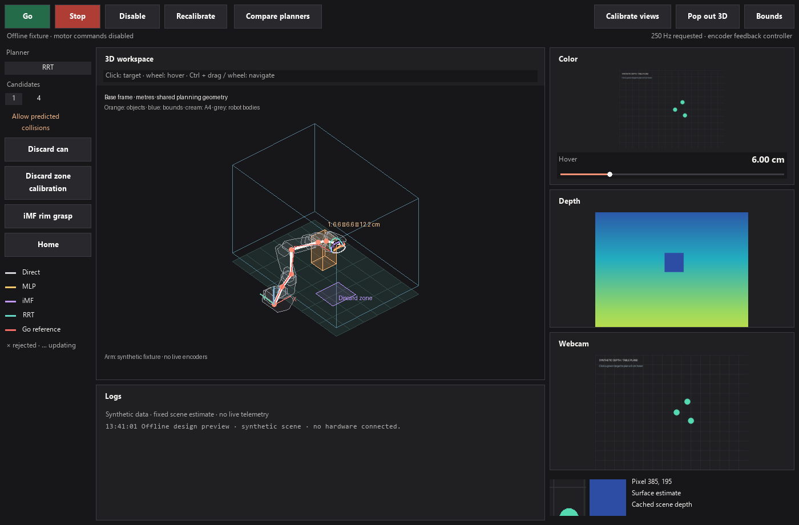
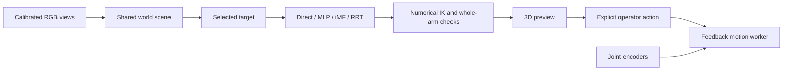

# DeskBuddy

[](https://github.com/AmirRoshankar/DeskBuddy/actions/workflows/tests.yml)


A desktop robotics workbench for learning **kinematics, visual calibration, feedback control and generative motion planning** with an SO-101 follower arm.

Click a target in a shared 3D scene, compare numerical and learned paths, inspect the full-arm geometry, and explicitly execute a checked trajectory. The same project includes offline flow-matching experiments and a soda-can grasp-and-discard workflow.



*The preview is a synthetic application fixture, not a recording of a successful physical grasp.*

## What works

- **Numerical FK/IK:** URDF geometry, measured joint ranges, calibrated tool point and bounded inverse kinematics.
- **Shared visual workspace:** RealSense RGB/depth, a second RGB camera, metric A4 alignment, interactive bounds and a pan/rotate/zoom 3D view.
- **Four simultaneous paths:** Direct, supervised MLP, improved MeanFlow (iMF) and joint-space RRT, with explicit planner selection and collision validation.
- **Feedback execution:** requested 250 Hz, measured loop timing, absolute-position retries, Kalman state estimates and bounded outer correction. Requested frequency is not guaranteed throughput.
- **Can experiments:** paired RGB-only can localization, nominal 66 mm diameter /122.22 mm height, body or learned rim proposals, post-lift RGB checks and up to five distinct grasp attempts.
- **Offline physics:** MuJoCo gravity/contact rollouts and separate physics-filtered iMF training. No hardware is needed for simulation or tests.

Physical reaching has been tried. **The rim-grasp/retry workflow is not yet physically validated.** A low model residual, collision preview or closed gripper does not prove real positioning accuracy or pickup success.

## Try it without hardware

Python 3.12+; standard Windows Python includes Tk. On Linux the interactive preview needs Tk and a display.

```bash
python -m venv .venv
# Activate .venv, then:
python -m pip install -e ".[dev]"
python -m deskbuddy demo --headless --output runs/offline
python -m deskbuddy demo
```

The headless demo uses synthetic geometry and CPU numerical IK. For optional features:

```bash
python -m pip install -e ".[flow,viz]"        # learning and plots
python -m pip install -e ".[simulation]"      # MuJoCo contact/gravity experiments
python -m pip install -e ".[camera,robot,perception]"  # optional live hardware stack
```

For Windows/NVIDIA setup, see [installation](docs/guides/installation.md). Hardware setup and calibration are separate from installation. After commissioning a private `configs/local.json`, double-click **Start DeskBuddy.cmd**. Startup reads state; it does not enable torque or command a reach.

## How the pieces fit



Flow models propose trajectories or grasp poses. Numerical IK still solves joints, and validators still check the resulting arm motion. The optional detector does not turn noisy depth into can detections: can mode fits a known-size cylinder to **two RGB silhouettes**, while depth remains available for display and other tasks.

## Results, with their limits

The geometric rim model achieved 89.8% held-out **pose validity**. That is not a physical pickup rate. A later contact/gravity benchmark exposed a much harder problem:

| One-step iMF on 246 matched held-out simulated cans | Pickup | Complete pick/transfer/drop |
| --- | ---: | ---: |
| Geometric-label model | 19/246 | 3/246 |
| Physics-filtered model | 44/246 | 6/246 |

These small, low-success results do not establish reliable model superiority. The physics checkpoint remains experimental. The toy simulator does not reproduce the full SO-101, measured fingertip/lid geometry, can deformation or liquid slosh. See [the complete experiment](docs/guides/can-physics-and-retries.md) and [model formulations](docs/research/model-formulation-audit.md).

## Project layout

```text
src/deskbuddy/       Application, geometry, control, perception and learning
tests/              Offline geometry, protocol, UI and simulation regressions
configs/            Public templates; local.json is private and ignored
scripts/            Setup, calibration and report tools
requirements/       Tested Windows/CUDA and simulation dependency records
docs/guides/        Current operation and architecture
docs/research/      Experiments, results and reproducible research notes
docs/assets/        Synthetic previews and plots
docs/archive/       Explicitly historical development documents
runs/               Ignored local models, datasets, recordings and runtime state
local/              Ignored machine-specific handoff and recovery archives
```

[Documentation index](docs/README.md) · [Controller](docs/guides/controller.md) · [Architecture](docs/guides/architecture.md) · [Maintainer handoff](docs/MAINTAINER.md)

## Development

```bash
python -m pip install -e ".[dev,flow,simulation]"
python -m pip install opencv-python
python -m ruff check src tests scripts
python -m ruff format --check src tests scripts
python -m pytest -q
```

Tests do not require an attached arm. Optional-dependency and local-checkpoint tests can skip on a fresh checkout. Generated training data, downloaded weights, raw camera frames and machine calibrations are intentionally excluded; training commands and measured summaries are included.

## License and attribution

Original code and the bundled SO-101 model notices use [Apache-2.0](LICENSE). The optional Ultralytics detector has its own [AGPL-3.0 / Enterprise terms](https://www.ultralytics.com/license); this project's license does not override dependency terms. Detector weights are not bundled. See [third-party notices](THIRD_PARTY_NOTICES.md).
