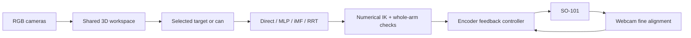

# DeskBuddy

[](https://github.com/AmirRoshankar/DeskBuddy/actions/workflows/tests.yml)


**Pick up a soda can and drop it into a selected discard area with an SO-101 robot arm.**

DeskBuddy combines computer vision, inverse kinematics and learned motion planning in a desktop app. Select targets in 3D, compare planners side by side, and watch the arm work through live camera views and an interactive world model.

## Demo

[](https://raw.githubusercontent.com/AmirRoshankar/DeskBuddy/main/docs/assets/success.mp4)

The arm picks up the can, moves it to the discard area and releases it. Recorded on real hardware. Preview at 3x speed.

[Full demo · MP4 · 100 seconds](https://raw.githubusercontent.com/AmirRoshankar/DeskBuddy/main/docs/assets/success.mp4)

## Features

- **Can pickup and discard** — can detection, grasping, transfer and release into a user-defined zone, with pickup checks and retries.
- **Four motion planners** — compare Direct, MLP, improved MeanFlow (**iMF**) and RRT paths in the same view.
- **Interactive 3D workspace** — select targets, drag bounds, inspect arm geometry, and pan, rotate or zoom the scene.
- **Multi-camera perception** — shared RGB workspace, webcam pour-hole detection and an auxiliary RealSense depth view.
- **Feedback control** — encoder feedback, Kalman state estimation, serial retries and configurable control timing.
- **Webcam fine alignment** — one-click tip tracking, measured local image Jacobians and bounded horizontal corrections.
- **Simulation and training** — flow-matching experiments, planner benchmarks and MuJoCo gravity/contact rollouts.

## Try it without a robot

Use Python 3.12+ with Tk available. Standard Windows Python includes Tk; Linux needs Tk and a display for the desktop interface.

```bash
python -m venv .venv
# Activate .venv, then:
python -m pip install -e ".[dev]"
python -m deskbuddy demo --headless --output runs/offline
python -m deskbuddy demo
```

The offline demo uses CPU numerical IK and synthetic geometry. Optional extras enable learning, simulation and hardware:

```bash
python -m pip install -e ".[flow,viz]"                  # model training and plots
python -m pip install -e ".[simulation]"                # MuJoCo gravity/contact experiments
python -m pip install -e ".[camera,robot,perception]"    # live cameras, arm and detection
```

For a commissioned Windows setup, double-click **Start DeskBuddy.cmd**. Startup reads cameras and joint state; motor hold and movement are explicit UI actions. See [installation](docs/guides/installation.md) and [hardware setup](docs/guides/hardware.md).

## From perception to action



Flow models propose trajectories, numerical IK converts them to joint motion, and whole-arm checks validate the path. Encoder and webcam feedback refine execution.

The control loop supports a **250 Hz update target** with timing instrumentation. Camera updates run independently.

## Explore the research

Explore the models, training setup, planner comparisons and physics experiments:

| Explore | Read |
| --- | --- |
| How MLP, flow matching and iMF are formulated | [Model formulation audit](docs/research/model-formulation-audit.md) |
| Trajectory learning and planner comparisons | [Trajectory learning](docs/research/trajectory-learning.md) / [Comparison](docs/research/planner-comparison.md) |
| Learned grasp proposals | [Rim-grasp training](docs/guides/can-rim-grasp-training.md) |
| Gravity, contact and pickup retries | [Physics experiments](docs/guides/can-physics-and-retries.md) |
| Whole-arm execution and checks | [Tracking and validation](docs/guides/whole-arm-and-tracking.md) |

## Find your way around

```text
src/deskbuddy/       Desktop app, perception, kinematics, control and learning
src/deskbuddy/ui/    3D workspace, camera alignment, tip selection and recording
src/deskbuddy/trajectory/   Trajectory planners, collision checks and scene tracking
tests/              Offline regression and simulation tests
configs/            Public templates; machine configuration stays local
scripts/            Setup, training, calibration and evaluation tools
docs/               Guides, research notes, results and the success demo
runs/               Ignored local datasets, checkpoints, recordings and runtime state
```

[Documentation](docs/README.md) · [Controller guide](docs/guides/controller.md) · [Architecture](docs/guides/architecture.md) · [Maintainer handoff](docs/MAINTAINER.md)

## Development

```bash
python -m pip install -e ".[dev,flow,simulation]" opencv-python
python -m ruff check src tests scripts
python -m ruff format --check src tests scripts
python -m pytest -q
```

Tests run without an attached arm. Local calibration, datasets and checkpoints stay in ignored folders. The public demo is in `docs/assets/`.

## License

Original code is [Apache-2.0](LICENSE). Bundled models and optional dependencies retain their respective terms; see [third-party notices](THIRD_PARTY_NOTICES.md).
