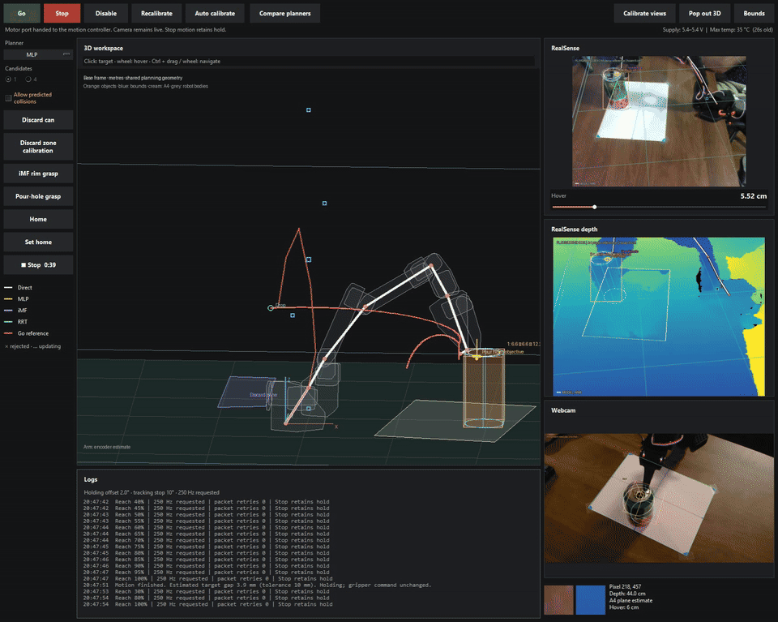
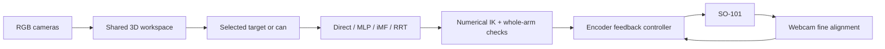

# DeskBuddy

[](https://github.com/AmirRoshankar/DeskBuddy/actions/workflows/tests.yml)


**An interactive robotics workbench that turns a tabletop scene into robot motion.**

DeskBuddy brings perception, inverse kinematics, motion planning and feedback control into one desktop interface. Built around a real **SO-101 follower arm**, it lets you select targets in 3D, compare classical and learned trajectories, and run can pick-and-transfer tasks while watching the robot's estimated world alongside its cameras.

## See it in action

[](https://raw.githubusercontent.com/AmirRoshankar/DeskBuddy/main/docs/assets/success.mp4)

**Real robot. Real can.** The `success` recording shows the arm picking up and transferring a soda can, with the live 3D workspace and camera views on screen. The looping excerpt runs at 3x speed.

[Watch the full 100-second recording](https://raw.githubusercontent.com/AmirRoshankar/DeskBuddy/main/docs/assets/success.mp4)

## What makes it interesting

- **Classical robotics meets generative planning.** Numerical FK/IK handles robot geometry; Direct, MLP, improved MeanFlow (**iMF**) and RRT trajectories can be viewed together and compared in the same scene.
- **A world model you can inspect.** Orbit, pan and zoom the 3D workspace, drag its bounds, select targets from camera or 3D views, and inspect whole-arm geometry and detected objects.
- **RGB-first tabletop perception.** Two camera views share an A4-based workspace. Known can dimensions support localization; the webcam locates the pour opening as a dark region near the can top. RealSense depth is available as an auxiliary view.
- **Feedback beyond the planned path.** Encoder feedback, Kalman state estimates, retry-aware serial control and bounded corrections address the gap between a planned motion and the physical arm.
- **One-click visual tracking.** Select the fixed jaw tip in the webcam. The can pregrasp controller can measure a local image Jacobian with small out-and-return probes, then refine horizontal alignment from observed motion. This is implemented and regression-tested; hardware evaluation is ongoing.
- **Grasp, lift, verify, retry.** Body, rim and pour-hole experiments share a pick/transfer/drop pipeline, post-lift pickup checks, a user-defined discard zone and up to five grasp attempts.
- **A reproducible learning lab.** Flow-matching experiments, model comparisons, whole-arm validation and MuJoCo gravity/contact rollouts run separately from hardware.

## Try it without a robot

Use Python 3.12+ with Tk available. Standard Windows Python includes Tk; Linux needs Tk and a display for the desktop interface.

```bash
python -m venv .venv
# Activate .venv, then:
python -m pip install -e ".[dev]"
python -m deskbuddy demo --headless --output runs/offline
python -m deskbuddy demo
```

The offline demo uses CPU numerical IK and synthetic geometry. Optional extras enable learning, simulation and hardware:

```bash
python -m pip install -e ".[flow,viz]"                  # model training and plots
python -m pip install -e ".[simulation]"                # MuJoCo gravity/contact experiments
python -m pip install -e ".[camera,robot,perception]"    # live cameras, arm and detection
```

For a commissioned Windows setup, double-click **Start DeskBuddy.cmd**. Startup reads cameras and joint state; motor hold and movement are explicit UI actions. See [installation](docs/guides/installation.md) and [hardware setup](docs/guides/hardware.md).

## From perception to action



**Flow proposes motion; IK solves geometry; feedback corrects execution.** The learned planner does not replace the robot model. Candidate trajectories are converted to joint motion and checked against the full arm. Near a grasp, visual correction operates in XY while height and insertion remain separate geometric tasks.

The controller supports a requested **250 Hz** update loop with timing instrumentation; achieved throughput depends on the serial bus and hardware. Camera updates run independently of the motor loop.

## Explore the research

The project makes the transition from geometric feasibility to physical manipulation visible: model inputs and losses, identical evaluation conditions, collision checks, simulation outcomes and real demonstrations are documented separately.

| Explore | Read |
| --- | --- |
| How MLP, flow matching and iMF are formulated | [Model formulation audit](docs/research/model-formulation-audit.md) |
| Trajectory learning and planner comparisons | [Trajectory learning](docs/research/trajectory-learning.md) / [Comparison](docs/research/planner-comparison.md) |
| Learned grasp proposals | [Rim-grasp training](docs/guides/can-rim-grasp-training.md) |
| Gravity, contact and pickup retries | [Physics experiments](docs/guides/can-physics-and-retries.md) |
| Whole-arm execution and checks | [Tracking and validation](docs/guides/whole-arm-and-tracking.md) |

The physical demo is an example execution, not a benchmark success rate. Quantitative simulation and held-out results live with their experiment definitions in the linked reports.

## Find your way around

```text
src/deskbuddy/       Desktop app, perception, kinematics, control and learning
src/deskbuddy/ui/    3D workspace, camera alignment, tip selection and recording
src/deskbuddy/trajectory/   Trajectory planners, collision checks and scene tracking
tests/              Offline regression and simulation tests
configs/            Public templates; machine configuration stays local
scripts/            Setup, training, calibration and evaluation tools
docs/               Guides, research notes, results and the success demo
runs/               Ignored local datasets, checkpoints, recordings and runtime state
```

[Documentation](docs/README.md) · [Controller guide](docs/guides/controller.md) · [Architecture](docs/guides/architecture.md) · [Maintainer handoff](docs/MAINTAINER.md)

## Development

```bash
python -m pip install -e ".[dev,flow,simulation]" opencv-python
python -m ruff check src tests scripts
python -m ruff format --check src tests scripts
python -m pytest -q
```

Tests run without an attached arm. Optional dependency and local-checkpoint tests may skip on a fresh checkout. Raw training data, weights, private calibration and camera snapshots stay out of Git; the selected public demo is included under `docs/assets/`.

## License

Original code is [Apache-2.0](LICENSE). Bundled models and optional dependencies retain their respective terms; see [third-party notices](THIRD_PARTY_NOTICES.md).
