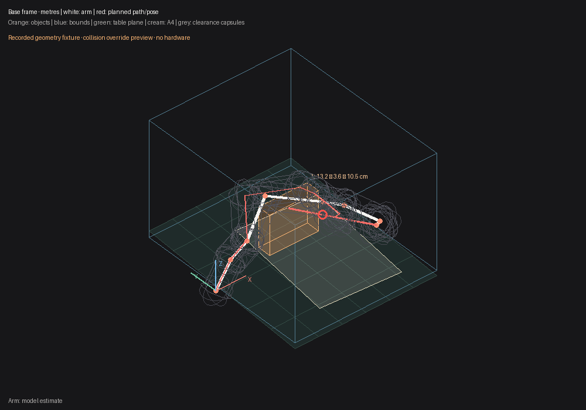

> Historical development record. See the current [project overview](../../docs/archive/legacy-readme.md) and [controller guide](../guides/controller.md) for supported behavior.

> Current implementation adds a low-motion Kalman tracker, full joint-space RRT,
> self-collision screening and key pickup. See [research and implementation notes](../guides/whole-arm-and-tracking.md).
> RRT with checks enabled now validates the whole arm during search. Learned XY
> proposals can use an explicitly labeled joint-space RRT repair/fallback. Their
> live checkpoints remain XY models. A new matched full-arm training experiment
> is documented in [learning and generalization](../research/learning-grasps-and-generalization.md);
> its checkpoints are not yet deployed.

# Choose and execute a trajectory

The main left sidebar now has **Planner** and **Candidates** controls. Choose
RRT, MLP, FM or iMF, then click a clear point in the main Color image. Changing
planner, candidate count or hover regenerates that target's preview. The red
path in Color, Depth and Kinematics is the actual checked joint reference.
**Go executes that selected route**; it does not replace it with a direct reach.
Selection and previews never issue motor commands.

Scene updates do not automatically cancel a running reach. Revision numbers and
box ordering are ignored as motion-fault signals; an 8 mm geometry deadband avoids
noise-driven path rechecks. Material updates refresh the live boxes and check the
remaining joint route on a background worker. Every next corrected step also uses
the latest boxes before its motor command. A clear route continues with a concise
log; a newly blocked route produces a controlled hold with its collision reason.
Results for obsolete object maps or already-passed route sections are discarded.
Brief snapshot read failures retain the previous scene (up to two seconds).
Grasp approach, descent/lift and Home use their own active route for these checks.
This checks continued validity; it does not automatically execute a new detour.

## Inspecting estimates and overriding predicted collisions

**3D scene** opens a read-only live view of the calibrated table/A4 plane,
workspace bounds, model arm, detected 3D boxes and selected joint trajectory.
Left-drag rotates, right-drag pans and the wheel zooms. Reset view restores the
camera. Toggle Clearance envelopes to see the same 35/45 mm capsules used by
the checker; the Planned pose slider shows the modeled arm along the route.
Box dimensions are in centimetres and world geometry is in metres. These are
model/depth estimates. Robot body outlines now come from the official URDF collision
meshes; the table check uses these bodies against the physical fitted table plane.
The moving jaw is shown over its opening envelope, not as a zero-width tip.

The sidebar **Allow predicted collisions** checkbox permits preview and Go even
when estimated object boxes or robot bodies/table overlap the
route. It defaults off on every launch. Predictions remain in the plan metadata,
3D markers and logs. With it on, learned models retain their raw proposed path
and skip clearance refinement; RRT can ignore obstacle boxes if its constrained
search has no path. No different planner is substituted. Estimated object-map
changes also cease to stop motion. Joint limits, self-collision checks, speed, workspace,
tracking, camera-monitoring freshness and Stop/Disable remain active. Unchecking
the override during motion requests a stop. Changing the setting while idle
regenerates the preview; toggling it alone never starts a reach.

The one/four candidate option applies to FM, iMF and RRT. MLP is deterministic
and uses one candidate; Direct also has no candidate search. The shortest
candidate passing Cartesian, numerical IK and joint-path checks is selected.
There is no automatic switch to another planner when a requested method fails.
A rejected route disables Go and reports the reason.

The live planner reserves gripper clearance consistently: 45 mm capsule radius
plus the calibrated tool-offset length and 2 mm interpolation allowance (about
60 mm for this arm). Earlier code planned the tip at only 18 mm clearance and
then rejected it with the larger arm checker; this mismatch is fixed. RRT searches
the enlarged scene directly. Learned paths are proposed using their original
conditioning, then locally refined for the live clearance when needed, with
fixed endpoints and at most 65 mm displacement per waypoint. Refinement uses a
constrained elastic-band optimizer, never RRT, and still must pass exact segment
and full-arm screening. The UI says “+ clearance refinement” and records the raw
proposal, correction size and final clearance in plan metadata. This hybrid
planning/IK cost is not the sub-millisecond raw inference time in offline tables.

Learned models still predict 32 XY waypoints. Numerical IK lifts a densified
route into joint poses, keeping a linearly changing hover above the calibrated
plane from the current tip height to the selected height. Joint travel is
parameterized by cumulative angular distance with a global quintic progress
curve and the configured speed cap. This is not an acceleration-constrained
industrial trajectory optimizer. Checks cover joint limits, speed, tip workspace,
table clearance, the tool's XY corridor and exact Euclidean capsule-to-box
distance for approximated arm links. Dense angular samples screen between reference waypoints.
These conservative proxies are not a mesh model or measured collision guarantee.

At Go, a new encoder read must be within 2 degrees of the preview start, or a new
preview is required. The worker uses the saved joint route and fresh hold-bias
compensation. During motion it checks corrected predicted arm geometry and the
camera scene snapshot. A changed confirmed object map, stale camera monitoring,
Stop aborts motion and retains position hold. Disable stops the worker and then releases torque for hand-guided positioning. Camera-scene checks run
at most 20 Hz independently of the requested 250 Hz servo loop. New scene changes
regenerate idle previews; they never automatically start a reach.

**Direct** retains the original numerical endpoint IK + quintic joint blend.
It does not route around obstacles and is blocked while objects are detected.
The old learned endpoint “Flow + IK” mode remains retired; flow models plan
trajectories, and all endpoint/waypoint IK is numerical.

**Compare planners** remains a separate preview-only benchmark window. Close it
before operating main-view Go. The new trajectory executor has offline and fake
bus tests; physical trials with these Cartesian routes have not yet been run.

## Where to read the code

**Home**, below Grab keys in the left sidebar, is an explicit motion command.
It plans a full-arm route from measured encoders to the default rest pose
`[0, -15, 30, 15, 0]°` using a private recovery workspace. It does not change the selected task bounds. Home permits predicted object/table overlap as requested, while retaining
self-collision, joint, workspace and feedback checks. After arrival
it ramps the gripper closed and reports obstruction if closure did not complete.
Arm hold must already be enabled. Stop/Disable cancels pending Home planning and
active execution. No Home motion has been physically commissioned by the agent.

The comparison popup has its own continuous Hover control and wheel adjustment
over the camera image. A small green dot marks the table click; a dotted line
connects it to the elevated ring. The selected height participates in numerical
joint lifting and full-arm validation. Its Valid column now uses those checks,
not just the old XY proxy. RRT is a full joint-space baseline. Rejected learned
paths remain visible as XY proposals, without hidden repair. Height changes clear
old results; press Compare paths again. The popup has no motor API.

### Downward grasp poses

Click & grab and Grab keys now constrain the physical gripper axis toward the
calibrated table normal. Numerical pose IK holds the calibrated jaw-tip position
while minimizing tilt; finger yaw is free and wrist roll is available during grasp
phases. This is shared by every approach planner, so existing flow/MLP checkpoints
do not need retraining. A far target may require a tilted approach or contact pose;
the preview reports the achievable contact tilt instead of assuming it is vertical.

The wrist position comes from URDF forward kinematics plus the calibrated TCP
offset, rather than blindly adding a fixed Z distance. On the commissioned arm,
the wrist-roll mount is about 100 mm above the tip for a perpendicular grasp.
The nominal contact TCP is 5 mm above the actual fitted paper plane; the wrist
and other arm links are tested using collision-body surfaces. This model clearance still
depends on accurate table/tool calibration and is not a physical contact sensor.

Execution follows the chosen approach route, aligns at a pregrasp point, then
descends and lifts along the table normal with orientation-aware waypoint IK.
Alignment, descent and lift are checked before any gripper command. Encoder
feedback must still point downward and be within 10° of the planned contact tilt
before closing. Stop and Disable retain their existing behavior. In 3D scene,
cyan shows the estimated contact arm pose, wrist-to-tip segment and descent;
the displayed angle is relative to perpendicular (0°). No physical grasp has yet
validated these new poses. A preflight error describes a future pose, not the arm's
current height. The contact preview displays its predicted body/table clearance;
an overlap is shown in red. The collision override permits the predicted overlap
but does not turn it into a successful or calibrated grasp.

This follows the standard separation of grasp pose, mount-to-TCP geometry and
Cartesian approach/lift used in the
[MoveIt Grasps tutorial](https://moveit.picknik.ai/main/doc/examples/moveit_grasps/moveit_grasps_tutorial.html).

- [gui.py](../../src/deskbuddy/gui.py): `preview_point`, `go`, detection and UI gates.
- [kinematics.py](../../src/deskbuddy/kinematics.py): `Arm.ik` and URDF forward kinematics.
- [planning.py](../../src/deskbuddy/planning.py): `plan_reach`, `interpolate_joints` and path checks.
- [control_plan.py](../../src/deskbuddy/control_plan.py): measured-start/held-goal compensation.
- [go_control.py](../../src/deskbuddy/go_control.py): exclusive worker launch and command interlocks.
- [execute_reach.py](../../src/deskbuddy/execute_reach.py): recheck and execute a target.
- [feedback_loop.py](../../src/deskbuddy/feedback_loop.py): timed feedback and retry loop.

## What Compare planners does

Object outlines now come from **YOLOE-26 Medium prompt-free segmentation** on RGB.
The displayed rectangle is the detector's image-space rectangle, not a projected
depth box. Filtered depth inside each instance estimates its 3D dimensions.
The calibrated paper/table plane and surfaces within 18 mm of it are excluded;
very thin objects are intentionally omitted. Projected robot-link masks exclude
the arm. Only raised geometry inside the paper and configured XY bounds is retained.
The known A4 corners are also projected into the image. Observed depth matching
that tilted plane is removed inside the paper footprint and a five-pixel edge
band. Distributed white edge observations robustly estimate a small depth-plane
correction: center offset is bounded to ±15 mm and corner offsets to ±40 mm.
The noise-aware exclusion band is 8–18 mm. This only changes perception, never
the robot calibration or motion bounds. Raised components remain eligible; a
merged paper/object prediction uses the raised component's image rectangle.
Missing depth is not treated as evidence that a pixel belongs to the paper.
Missing depth can retain a matched estimate for at most two seconds. Model
loading and inference run on a background worker. Names are not trusted as
collision semantics; all accepted raised instances are generic boxes.

Noise stabilization: a blurred 160×120 grayscale comparison skips inference
unless at least 1% of pixels change by more than 12 brightness levels after
removing uniform exposure shift. A two-second refresh catches slow changes.
Published boxes stay fixed within an 8 mm / 8 pixel deadband; changes need three
consistent detections and removals need five. Matching ignores detector order
and confidence changes. Pending changes bypass the quiet-image skip. Geometry
or calibration edits reset the filter. These thresholds are in
`trajectory/scene_stability.py` and `trajectory/yolo_perception.py`.

Install `.[perception]` using `constraints-cuda.txt`. Put the official
`yoloe-26m-seg-pf.pt` weights in `runs/flowreach/perception/`. Runtime never
downloads weights or installs packages automatically. Detection failures are
reported in the live snapshot; there is no silent depth-only fallback.

It uses the same detected box geometry, current model-estimated tip XY and selected
goal for MLP, FM, MF, iMF and RRT. Each learned model predicts all 32 XY waypoints;
the checker rejects entire segments crossing inflated boxes. Selecting a row shows
its proposed path. Rejected paths are displayed as rejected; there is no hidden
RRT replacement. RRT is a separate baseline row.

The comparison window itself remains camera-fed preview only. Its results are
not executable references. Use the main sidebar to regenerate a joint-validated
route for Go. **Compare planners has no motion API.**

## Main-view comparison and second RGB camera

Direct (white), MLP (gold), iMF (purple) and RRT (teal) are drawn together.
Solid lines pass preview checks; dashed lines are rejected proposals. Go executes
the selected sidebar planner's validated route, not every comparison line.

The third panel supports a USB webcam selected by friendly name in
`secondary_camera`, for example `{"name": "Brio 101"}`. Enable the camera config
while the viewer is stopped. **Calibrate views** freezes a pair of RGB frames.
Mark the same four A4 corners in both views, in matching order with the first
edge measuring 21 cm. Blue markings check correspondence. Check alignment,
review the numbered corners and residuals, then Save alignment. New snapshots
refreshes the pair if needed. Moving either camera invalidates the alignment.

A paper homography calibrates the table only. Elevated 3D projection is enabled
only after independent RealSense-depth feature checks pass. Otherwise the webcam
confirms visible object contact edges on the paper without claiming calibrated
height. Pending detections require three hits; confirmed tracks persist through
brief occlusion. This intentionally trades fast removal for reduced flicker.

Alignment corners can be dragged directly in either image. Save alignment also
runs a check if necessary and accepts failed quality checks, preserving their
warnings. Interior depth medians replace worst-corner depth vetoes; noisy depth
never overrides the known-size A4 pose. A failed quality check does not certify
elevated 3D calibration. Crossing/degenerate corners must still be corrected to
produce an invertible mapping. No alignment control commands the motors.

### Two-view obstacle map and continuous reaches

The webcam now triggers refreshes independently of RealSense RGB changes.
Both views are required for new obstacles when the webcam is configured. A
missing or stale alignment does not silently create new single-view obstacles;
confirmed old tracks still survive brief occlusion. Webcam masks are trimmed to
raised, measured RealSense world points within the paper/playground and outside
the robot mask. Sheet-sized masks are rejected. Associated nearby fragments are
merged into one world box; neither camera creates a separate second 3D object.
This can recover surfaces omitted by primary RGB segmentation, but cannot invent
an unseen backside or provide independent webcam depth. With a plane-only pose,
projection/fusion remains explicitly estimated, not independently validated 3D.

Published boxes use a 20 mm / 16 pixel deadband, four confirmations and six removal
confirmations. The cheap image gate requires 2.5% local change above 18 brightness
levels, with periodic refresh retained. A scene revision alone never restarts a
reach. A clear remaining route continues unchanged. If updated objects block it,
the worker holds its last command, plans from fresh encoder feedback to the same
goal using the selected planner, and resumes automatically. Stop/Disable cancels
that continuation. No replacement within 45 seconds retains hold with a reason.
Replan result metrics currently describe the final segment and include a replan
count; they are not aggregate energy/timing metrics for the interrupted route.

Planner lines have both colored legends and labels on the curves. A trailing
ellipsis marks the previous comparison while its replacement is being computed;
rejected/unlifted proposals remain dashed. Some planners can genuinely fail to
produce a drawable route; the legend still identifies their rejected result.

The separate **iMF grasp** button loads the actual offline-trained box checkpoint
and displays sampled centers, orientations, openings and geometric validity. It
has no motor callback. Executable use still needs the opening-dependent transform
from model jaw-center to the calibrated fixed-jaw TCP, followed by reachability,
whole-arm checks and real grasp validation. It never silently executes the default
grip routine and calls that an iMF grasp.

## Current controls and recovery

The main 3D workspace is the common planning-scene view, showing encoder-estimated
arm pose, the shared two-camera boxes, the horizontal table, bounds and planned
routes. Camera feeds are stacked on the right. Click a feed or the 3D workspace
to select the same world target. Camera clicks intersect that camera's calibrated
table plane; 3D clicks intersect the current hover plane. Wheel adjusts hover;
Ctrl + left drag rotates, Ctrl + right drag pans, Ctrl + wheel zooms the main 3D
view. Paths/ghost poses clear after a job ends. The sidebar owns the color legend.

Disable now stops active workers and then explicitly releases all six motors;
support the arm before pressing it. Enable writes verified current encoder goals
before enabling arm hold, so it locks the hand-guided pose rather than replaying
the old goal. Stop retains hold and does not release torque. Startup still sends
no torque or movement commands.

The live speed default is 24 degrees/s, with a 30 degrees/s software envelope,
continuous references and the existing 0.4-degree per-command jump guard. Loop
progress uses bounded measured cycle time, avoiding an extra slowdown when a
250 Hz request cannot be serviced at 250 Hz. This is not a measured motor-speed
specification. Grasping cannot lower the operator's Z floor. Home uses private
recovery bounds and ignores predicted table/object overlap; normal task bounds
remain unchanged. It still validates joint feedback and nonadjacent self geometry.
Self collision now uses separate URDF collision parts and a convex overlap check,
rather than the old universal 40 mm joint-line rule. Mesh concavities and the
nominal closed moving jaw remain model approximations, not contact sensing.

## Single 355 ml can disposal

Select **Discard zone calibration**, then click four perimeter corners in any
view. The zone is a horizontal quadrilateral, independent of paper calibration.
Saving expands XY selection bounds to contain it and preserves the Z bounds.
The purple zone appears in 3D. **Discard can** detects the upright can-sized shared
foreground object, preflights approach/descend/lift/transfer, then executes and
opens the gripper with its tip inside the zone. This flow assumes no other objects
need avoidance. It currently assumes a standard 66 mm diameter, 122 mm high can;
355 ml volume alone does not identify all possible can shapes.

**iMF grasp** is an executable alternative in can mode: a separate can-profile
checkpoint samples 32 object-relative poses; up to three valid candidates get
numerical IK, full trajectory validation and duration ranking. There is no silent
baseline fallback if none passes. The learned model proposes geometry; numerical
IK and the same feedback controller execute it. Closure/transfer remain analytic,
not a contact-trained ML policy. MLP/FM/iMF/GraspMF adapters were trained on the same
6,000 procedural cylinder examples with whole-object splits and 5,000 updates.
These labels and validity rates are not measured pickup success.

The fixed-jaw-to-jaw-center adapter uses nominal URDF hinge geometry and the
commissioned opening percentage as an approximate angle. Opening is selected for
the can width; closure stops near that width rather than commanding fully closed.
The sequence reports completion separately from physical pickup/drop verification.
No physical can trial was run by the coding agent. First trials still need direct
observation of pose accuracy, opening calibration and grip retention.

3D navigation now reuses view-independent body geometry, collision annotations and
sampled path vertices. View drags only project/draw that data, with mouse events
coalesced to the latest pointer position. Frame fitting stays fixed until bounds
change or the view is reset, so noisy observations do not recenter a drag. Both
3D views use Ctrl + left drag to rotate, Ctrl + right drag to pan with the pointer,
and Ctrl + wheel to zoom; orbit remains above the tabletop. RealSense capture is
on a latest-frame background thread, so SDK frame waits cannot stall Tk input.
This display caching/decimation does not alter control or collision-validation data.

### RGB-only can localization and iMF rim grasp

Can mode uses YOLOE-26 Small on both RGB images in one GPU batch. Depth remains visible but does not accept, reject, locate, or resize cans. The discard action also does not refine the can center from depth. Other legacy task modes retain their depth-based arbitrary-object geometry.

The RGB geometry fits a nominal upright cylinder, 66 mm diameter and **122.22 mm height**, against the calibrated silhouettes. These dimensions are assumptions, not measurements. Both camera calibrations must still match their views; use **Calibrate views** after moving a camera. Existing Kalman tracking and scene-change deadbands remain active.

**iMF rim grasp** samples lip poses from the synthetic rim checkpoint, ranks the side near the current jaw, and uses the first fully validated approach, descent, lift and discard-zone transfer. Jaw-center contact is nominally 2 mm below the can top, with 7–9 mm approach opening and 1.5 mm nominal closing gap. This pinches the rim rather than enclosing the can body. It uses no depth-based height. The numerical **Discard can** action remains the body-grasp baseline.

The learned model proposes the object-relative grasp pose and opening. IK and the whole-arm planner produce the motion; iMF does not directly control motors or learn contact forces. Training labels are procedural geometric targets, with no contact physics or real pickup-success labels. A visually plausible proposal does not prove a can will be held. Sequence completion is reported separately from unverified pickup success. Only pressing the UI action starts execution.

Planner latency changes: selected execution evaluates only the requested model; main comparison skips unused FM and duplicate 2D RRT. Already validated learned/RRT previews avoid duplicate validation. Exact convex support hulls cache the same 23 sampled jaw openings for table-clearance calculations.

Rim grasps may use up to 35 degrees of approach tilt to keep the jaw-center position accurate within joint limits. The discard goal has no artificial downward-orientation requirement; actual zone edges and corners are sampled, and the carried can is checked against the table. If no validated transfer is found, the UI asks for a closer discard zone. Multi-candidate rim planning shares a 20-second search budget instead of repeating a full drop search for each proposal.

### Post-lift check and retries (new code; hardware test pending)

Can disposal now verifies RGB body motion after lifting. Confirmed pickup permits transfer; a confirmed can-left-behind result triggers another preflighted approach, up to five total attempts. Ambiguous/stale imagery stops with hold retained and no automatic opening/retry. The viewer publishes fresh raw pickup JPEGs, so reload the idle viewer before using this update. No physical movement is currently authorized until the user returns and explicitly permits it. Drop remains unverified. See [physics and retry evidence](../guides/can-physics-and-retries.md) and [complete handoff](../MAINTAINER.md).
