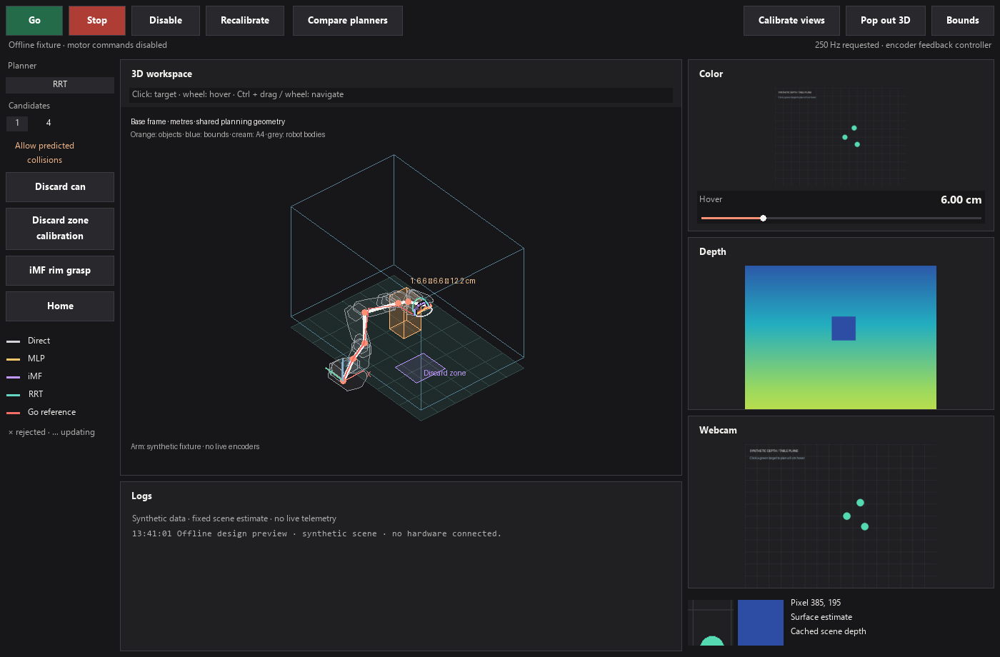

> Historical development record. See the current [project overview](../../docs/archive/legacy-readme.md) and [controller guide](../guides/controller.md) for supported behavior.

# SO-101 Click-to-Reach → FlowReach

A robotics learning project: select a shared world target from a 3D workspace or
either calibrated camera, solve numerical IK, and compare motion planners on an SO-101 follower.
Separate MLP, flow matching and improved MeanFlow models generate full
32-point XY paths. Main sidebar planner/candidate controls regenerate a checked
joint trajectory using numerical waypoint IK; Go executes that displayed route.

**Current checkpoint:** calibrated RealSense D435 and SO-101, a native charcoal/orange dashboard,
numerical IK, explicit click → preview → Go, 250 Hz requested feedback with packet retries,
persistent scene observations, an A4 test surface, and a verified CUDA environment.
Physical reaching trials have run with the numerical baseline and both learned proposals.
The [small hardware comparison](../research/flowreach-hardware.md) records three completed
1 cm reaches and one rejected learned proposal; it does not establish a model ranking.
Camera/model consistency has been checked; independent absolute positioning accuracy has not been measured.



See [what the Go button actually does](controller-history.md) and the
[plain-language planner comparison](../research/planner-comparison.md). **Compare planners**
uses RGB YOLOE-26 Medium object outlines with filtered-depth box estimates and the same scene for MLP, FM, iMF and joint-space RRT. Its Valid column now checks the entire arm at the selected hover height.
Click a clear target in its camera view, choose one or four candidates, then
**Compare paths**. Select a row to view its proposed path. This window is preview-only.
For execution, close Compare, choose a planner and candidate count in the main
left sidebar, click a target and press Go. Requested methods never silently fall
back. Direct remains a separate endpoint-only baseline blocked by detected objects.
The trajectory executor has offline/fake-bus validation; physical Cartesian-route
trials have not yet been run.

The preview above uses synthetic fixture data, not a camera recording.

The main UI now includes a single-can disposal mode: **Discard zone calibration**
marks four corners, **Discard can** runs the analytic cylinder grasp, and **iMF grasp**
automatically samples/ranks can-profile proposals before numerical validation.
Both use a nominal URDF jaw-center adapter. Can pickup/drop is not physically
validated; synthetic geometric validity is separate from pickup success.

See [tracking, whole-arm planning and key pickup](../guides/whole-arm-and-tracking.md)
for the Kalman tracker, joint-space RRT, full-body training preparation and
Click & grab / Grab keys controls. Physical key pickup remains untested.

See [learning grasps and closing the simulation gap](../research/learning-grasps-and-generalization.md)
for the research review and a matched 3,643-trajectory full-arm experiment.
The tougher held-out benchmark exposes weak obstacle-routing generalization;
these research checkpoints have not replaced the live XY models.
The sidebar also includes Home, which plans a checked rest-pose route then closes
the gripper, and the 3D viewer now displays the same robot bodies used for table checks.

**Enable / Disable** is one control. If motors are off, Enable asks you to support
the stationary arm, writes and verifies its measured pose, and enables hold. Keep
the support in place for the check, then remove it carefully and confirm hands
clear in the UI. Go stays blocked until that confirmation. If hold is already on,
Enable simply permits commands again. Disable stops an active reach and persistently
blocks new commands while retaining hold and read-only monitoring; it does not cut
power or release torque. Select a fresh target and press Go to start a reach.

**Bounds** edits the playground's X/Y/Z minimum and maximum in centimetres relative
to the robot base. A blue wireframe shows the 3D box in both camera views. Uncheck
“Also restrict targets to A4 inset” to use the box without the paper selection limit;
the paper plane still supplies the tabletop estimate. Applying saves the bounds
and clears the preview without moving. Joint travel, table clearance, reachability,
tracking and velocity checks remain active. Bounds and calibration changes do not
disable the learned seed: IK refines it against current geometry. UI logs show
numerical fallbacks and their reason; structured reports retain full planner use.

Use the Bounds editor to resize the box; camera clicks select targets. Previously, drag handles were used to drag
**Move XY** to translate it across the table. Release saves; Escape cancels. Bounds
editing never starts motion and clears the old preview. Three dotted perpendicular
guides connect the selected target to the nearest X/Y/Z box faces; the former
hover-height outline has been removed. With hold off, previews use measured joints,
not reset or stale goal registers.

The [DeskBuddy roadmap](roadmap-history.md) reconciles the research handoff
with this codebase and proposes a separate obstacle-aware trajectory benchmark.
The [offline trajectory baseline](../research/trajectory-baseline.md) provides 5,000
scenarios and 10,000 checked 32-point teacher paths. Separate MLP/FM/MeanFlow/iMF
trajectory models are now [trained and evaluated](../research/trajectory-learning.md)
for obstacle avoidance in 2D; these are not yet connected to the live arm.

On the configured Windows workspace, double-click **Start DeskBuddy.cmd** in the
workspace root to open the controller using its existing `.venv`. It detects an
already running viewer and preserves Disable. Startup reads camera and encoders;
it never enables torque or starts a reach. The launcher expects this workspace's
`outputs/click-to-reach` layout and a commissioned `configs/local.json`.
See the [architecture](../guides/architecture.md), [design tokens](../../DESIGN.md), and
[communication measurements](../reference/communication_timing.md).
See [FlowReach training and results](../research/flowreach.md) for the learned experiment.
The [learned-field analysis](../research/flowreach-analysis.md) explains the MLP baseline,
includes interactive velocity/workspace plots, and compares estimated motor energy.

## Run the preview

Python 3.12 or newer is required. The preview runs on CPU and needs no robot or camera.
Tkinter is included in the standard Windows Python installer. On Ubuntu, install `python3-tk` for the GUI.

```powershell
python -m venv .venv
.\.venv\Scripts\python.exe -m pip install -e '.[dev]'
.\.venv\Scripts\python.exe -m deskbuddy demo
```

Click a green target. The right panel animates the arm and shows its end-effector path
from the side and above. The target is 6 cm above the synthetic tabletop.
The latest preview is saved to `runs/last_plan.json`.

To reproduce the checked-in artifact and benchmark without a display:

```powershell
python -m deskbuddy demo --headless --output runs/offline
python -m deskbuddy benchmark
python -m pytest -q
python -m ruff check src tests
python -m ruff format --check src tests
```

After creating a virtual environment, use its Python executable or activate it before running commands.

For a new checkout on a Windows NVIDIA machine, `./setup-windows.ps1` installs the tested
CUDA pair and optional camera/arm packages into a new local `.venv`.
It does not change the system driver, connect to motors, or calibrate hardware.
PyTorch wheels supply the CUDA runtime needed here; a separate CUDA toolkit is unnecessary.
`start-demo.ps1` launches the preview using the local environment (or the prepared environment
in the original workspace). `requirements-windows.lock.txt` records the complete tested
package versions, while `constraints-cuda.txt` keeps setup on the matching CUDA pair.

## How the baseline works

```text
RGB click + observed/cached depth or mapped A4 plane
        ↓
3D point in camera optical coordinates
        ↓  measured rigid transform T_base_camera
3D point in robot base coordinates + vertical hover offset
        ↓
position-only IK with URDF joint bounds
        ↓
quintic joint interpolation + path validation
        ↓
animated preview + JSON trajectory
```

- **Projection:** synthetic data uses the pinhole equation; RealSense uses SDK deprojection
  with the aligned depth intrinsics. A small depth neighborhood rejects missing data and depth edges.
- **Calibration:** an SVD rigid fit estimates `p_base = R @ p_camera + t` from matching points.
- **Forward kinematics:** joint transforms compose along the official URDF chain.
- **Inverse kinematics:** bounded nonlinear least squares minimizes XYZ error, with a small
  posture penalty favoring a solution near the current seed.
- **Motion:** the quintic blend `10s³ − 15s⁴ + 6s⁵` gives zero endpoint velocity and acceleration.
  Duration scales to respect the configured joint speed limit. This is a joint-space path,
  so the tool does not necessarily follow a straight line in Cartesian space.

All positions are **metres**, and internal joint angles are **radians**. Human-facing configuration
uses degrees. The SO-101 has five arm joints plus the gripper; this project solves position only
and leaves the gripper alone. It does not promise arbitrary six-dimensional tool poses.

## Verified results

The saved [offline benchmark](../research/offline/benchmark.json) uses 30 nearby targets generated
from known model poses with seed 42. All 30 passed the current planning checks.
Planning took about 11 ms at the median on the development machine.
These are model consistency results; the very small FK/IK residual is **not real robot accuracy**.
The 2 mm IK threshold is a software acceptance criterion, not a physical accuracy claim.

The development environment passed a real GPU optimization smoke test on an RTX 5070:
PyTorch `2.11.0+cu128`, torchvision `0.26.0+cu128`, CUDA runtime 12.8, Python 3.13.7.
The test trains a tiny regression network; it is not the future flow-matching model.

Tests cover depth rejection, projection, transform recovery, degenerate calibration,
FK/IK consistency, unreachable targets, workspace/joint/speed/table checks, and plan serialization.

## Connect a RealSense

```powershell
python -m deskbuddy devices
Copy-Item configs/local.example.json configs/local.json
python -m deskbuddy camera --config configs/local.json
```

Install `.[camera]` if the SDK is not installed. Set `camera_serial` when more than one camera is present.
The viewer opens RGB and aligned depth at 640×480. Without calibration, each click records camera XYZ
to `runs/camera_clicks.jsonl`. It does not invent a camera-to-arm transform.
With the calibrated arm attached, add `--robot-state` for a passive live model and hand-guided
tool-point calibration capture. Startup keeps torque unchanged. Only explicit supported
release/hold confirmations in the calibration workflow change torque.
See [hardware commissioning](hardware-history.md) for the next steps.

**Recalibrate** starts an inline four-step workflow and disables Go:

1. Support the arm, then explicitly confirm **release hold** in the UI.
2. Close the jaws by hand and click the same jaw-tip point at eight varied stationary
   poses, including different heights. The eighth capture fits six points and checks
   two held-out points automatically. If a tool-offset candidate is needed, capture
   two additional fresh poses. **Use checked camera fit** appears only after passing.
3. Flatten the A4 sheet and click its four corners around the perimeter. Start with
   any corner, then its neighbor along the **210 mm short edge**. Review the projected
   outline, retry if needed, and choose **Use paper bounds**.
4. Support the arm above the paper and explicitly confirm **restore hold**. After the
   hold check, remove the support carefully and confirm **arm holding, hands clear**.

All actions stay in the UI; no terminal command or chat acknowledgement is needed.
Starting recalibration itself preserves torque. Go remains disabled until the fit,
paper bounds, supported hold and final operator confirmation are complete. Arm capture
progress is saved locally; a restart can require repeating the paper/hold steps.

After camera relocation, a fixed jaw-tip offset of approximately `[12.7, 3.1, 0.5]` mm
in the URDF tool frame passed two fresh checks at 5.9 and 3.4 mm. Joint zeros were
unchanged. The configured `tool_offset_m` is used consistently in FK, IK, overlays,
path checks, and execution reports. These are camera/model consistency checks, not
independent measurements of commanded reach accuracy. A4 sheet dimensions have not
independently been measured with external metrology.

The A4 test bed uses a 210 × 297 mm rectangular pose fitted to four image-reviewed
corners and checked against depth. The outer cream outline marks the paper; the
green grid is inset 20 mm from each edge. Clicks intersect the fitted paper plane,
and both UI and execution reject targets outside the inset footprint. Moving the
sheet requires remapping it; moving the camera requires camera recalibration too.
The sheet may be tilted in robot coordinates: hover and sampled link-origin checks
use the fitted plane's height at each XY location, rather than a horizontal plane
through its highest corner. A 3 cm corner-height difference is not a rejection.
Initial corner fit errors were 2.3–2.7 pixels; depth discrepancies were 7–18 mm,
so this is an approximate test-surface estimate rather than precision metrology.

## Live viewer and hardware trials

Use the wheel over the camera or dashboard to adjust preview hover height.
Up raises the target; down lowers it. Full notches change height by 2 mm, with
fractional input supported. The nominal range is 2–20 cm above the selected
surface; table-clearance checks can raise the minimum. The height control also
supports dragging and arrow keys. Changes replan the preview and never start
motion; press Go to execute. Wheel input over Logs scrolls the log instead.
Panels expand with the window, keeping 8 px gaps and undistorted camera images.

The [read-only communication benchmark](../reference/communication_timing.md) measures
serial latency and scheduling deadlines without moving the arm. It identifies
candidate update rates; actual control-loop timing and tracking still need validation.

The current hardware configuration requests **250 Hz**. Every iteration reads joint
feedback, checks the 10-degree tracking envelope, and refreshes an absolute position
target. Transient read/write failures freeze trajectory progress and retry on the
next iteration; they do not skip ahead or replay relative movements. Goal-register
readback at 10 Hz detects unacknowledged targets without doubling every cycle's bus
traffic. Sustained feedback loss (250 ms), unconfirmed goals (500 ms), or excessive
tracking error stops the reach while retaining hold. Logs distinguish requested
rate, achieved rate, successful command rate, retries, and missed deadlines.

Camera observations update a persistent, camera-aligned point cloud. Missing depth
preserves prior observations and increases uncertainty. Scalar Kalman updates smooth
valid depth; isolated large spikes are rejected, while three consistent changed
readings establish a new surface.
On the mapped A4 bed, clicks use the fitted plane even when no live depth exists.
Elsewhere, observed or cached neighboring depth provides an age-labelled estimate.
Go uses the frozen world target and encoder feedback, without requiring another
valid depth frame. Camera outages retain the last view and mark it stale. The
point cloud is exported locally as `runs/live/scene_points_base_m.npy`. Recalibrate
clears it. This projective map is not SLAM or a mesh collision detector, and unseen
areas without a mapped surface cannot supply an invented target.

The viewer shows RGB and depth side by side, color and colormapped-depth cursor zooms on
the far left, and side/top kinematic diagrams beneath the cameras with an event log alongside.
Voltage and temperature readings are displayed and logged locally in `runs/telemetry.jsonl`.

With a commissioned arm already holding its pose, click a clear tabletop point to preview.
**Only pressing Go executes a reach.** Invalid selections clear the previous target.
The live default is 24 degrees/s, with a 30 degrees/s software envelope; the controller retains configured workspace,
joint, and sampled path checks. Explicit joint bounds use this arm's saved hand-measured encoder ranges, converted through LeRobot degree normalization
and the calibrated joint zero offsets. They replace the generic URDF bounds; they
are not silently intersected with them or trimmed by an extra 3 degrees. Without
explicit bounds, the URDF limits remain the default. These recorded ranges are
commissioning measurements, not an independent mechanical collision envelope. Wrist roll stays fixed. Go uses a snapshot of the
selected world target and calibration, without requiring fresh depth. A stationary
measurement initializes the holding correction so the first command matches the
existing hold target. A bounded outer PI controller then updates that correction
from estimated encoder state on every iteration, rather than freezing it for the trial.

A constant-velocity Kalman filter estimates joint angles and velocities. Raw encoder
feedback still enforces the 10-degree tracking limit, so filtering cannot hide a stall.
Reference progression slows when tracking error grows, leaving correction headroom.
Commands retain joint, speed, step-size and sampled table-clearance checks.
Each original trajectory interval is subdivided without stretching its duration.
The desired endpoint is never reset to the current feedback to hide accumulated error.
Settling lasts 0.5–4 seconds and reports whether joint convergence was achieved.
See [adaptive feedback](../guides/adaptive-feedback.md) for assumptions and validation limits.
The arm can start outside the selection footprint and enter through an inward waypoint.
Starting height may be at most 1.5 cm outside the vertical workspace. The path must reduce
the boundary violation monotonically and still pass all hard table and joint checks.
This permits entry from beside the paper without expanding the target region.

**Stop motion (hold)** stops the trial and retains position hold; it does not release torque.
Restoring initial hold at an operator-supported, stationary pose verifies raw encoder
targets before enabling torque. It does not use the reach planner's model angle bounds
as a holding gate; those bounds still apply to new reach trajectories.
It retains the last commanded hold target, avoiding downward drift from repeatedly
resetting targets to gravity-deflected encoder positions.
Closing the viewer during a Go trial requests a stop first. Closing it otherwise preserves
the existing torque state. Support the arm before deliberately releasing torque or removing power.

Each Go trial writes its selected and executed plans, results, and logs to a separate
folder in `runs/control/jobs/`. Camera frames, serial settings, calibration files, and local
logs stay outside Git.

The calibrated selection region is always drawn as a line grid on the camera views.
It represents configured bounds, not a guarantee of collision-free reachability; IK and
path checks still run per selection. `python -m deskbuddy.grid_preview` assesses a 3×3
grid offline and saves `runs/grid_preview.json`; it never runs a physical sweep.
A live tracking-fault banner names unexpected tracking loss during execution.
Each new Go checks that the arm is stationary and measures a fresh holding offset;
the correction adapts during the move while the desired endpoint stays unchanged.

The live arm diagram uses measured encoder angles and is never animated by selecting a
target. The red physical path starts at measured angles; the initial correction makes
the first motor command match the existing hold. Subsequent corrections use feedback. The robot base frame
and camera calibration stay fixed.

Video overlays project the current model arm (white links/orange joints), the planned
tip trajectory and dashed end pose (red), and selection bounds at the hover height
(teal). They depict model centerlines, not a mesh collision envelope.
They also show the encoder/model tip estimate in magenta, the elevated hover goal
in green, and the original surface click in gray. Both the 3D model gap and projected
pixel gap are displayed. These are model projections, not independent camera tracking.
Completing the command sequence is reported separately from reaching the model target
within the default 10 mm position tolerance. Projected overlap alone does not establish
3D success, because points at different depths can share a pixel. Independent physical
accuracy still requires observing or measuring the actual tool point.

The [first hardware trial](../research/results/first_reach_results.json) took 14.5 seconds including settling,
at a 3 degrees/s command limit. The largest joint tracking error was 2.84 degrees;
the settled encoder/model tool position was 21.3 mm from the requested target.
The motion was visibly slow and somewhat choppy. Speed, tracking, and smoothness tuning
remain future work; this is not a precision manipulation result.

The [calibration results](../research/results/calibration_results.json) separately report 3.3 mm and 5.6 mm
camera/model errors on two fresh observations excluded from model fitting. Those are
different measurements from a physical commanded reach and should not be conflated.

Current checks cover sampled joint bounds, speed, tool workspace, endpoint residual,
and link-origin height above the table. The controller checks encoder tracking and timing
and stops on communication errors. It does **not** detect self-collisions,
mesh/table collisions between link origins, or arbitrary obstacles. Trials need a clear workspace.

## Next: conditional flow matching

Once physical reaching is repeatable, keep the same perception, kinematics, and validation code.
Train a small network to generate intermediate trajectory waypoints conditioned on the starting
configuration and target. Begin with synthetic teacher trajectories; label that data explicitly.
Keep endpoint constraints and validate every generated path. Compare on held-out targets using
valid-plan rate, endpoint error, path length, smoothness, and planning latency.

The learned model may not beat this simple baseline. Demonstrating that comparison is part of the project.
See the [experiment plan](flow-matching-history.md).

## Sources and license

- [SO-101 hardware and calibration](https://huggingface.co/docs/lerobot/main/so101)
- [Official SO-101 model and calibration conventions](https://github.com/TheRobotStudio/SO-ARM100/tree/main/Simulation/SO101)
- [RealSense deprojection](https://dev.realsenseai.com/docs/projection-in-intel-realsense-sdk-20)
- [Flow Matching for Generative Modeling](https://arxiv.org/abs/2210.02747)

Apache License 2.0. See [third-party notices](../../THIRD_PARTY_NOTICES.md) for the pinned robot model.
