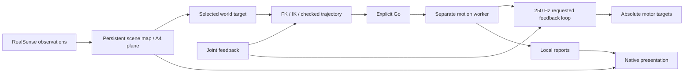

# Architecture

The project uses LeRobot's serial transport directly. ROS 2 is not a runtime
dependency. Offline tests cover geometry, controller behavior and installed model assets.

## Responsibilities

| Layer | Modules | Responsibility |
| --- | --- | --- |
| Presentation | `ui/theme.py`, `ui/widgets.py`, `ui/layout.py`, `ui/hover.py`, `ui/viewport.py`, `views.py`, `overlays.py` | Theme, resizable composition, preview height input, aspect-preserving click mapping and diagrams; no hardware commands |
| Application | `gui.py`, `cli.py` | Operator events, selection, capture sessions and lifecycle |
| Geometry | `geometry.py`, `kinematics.py`, `planning.py`, `control_plan.py` | Coordinate transforms, calibrated tool point, IK, limits and trajectory validation |
| Perception | `camera.py`, `scene_map.py`, `test_bed.py` | Acquisition, incremental camera-aligned point cloud, cached observations and known tabletop plane |
| Execution | `go_control.py`, `execute_reach.py`, `feedback_loop.py`, `adaptive_control.py`, `state_estimation.py` | Immutable Go snapshots, process ownership, feedback-gated progression, retry/readback policy and reporting |
| Hardware access | `passive_arm.py`, `hold_position.py`, `calibrate_arm.py` | Separate read-only state, supported holding, and motor calibration workflows |

## Motion and perception are separate clocks

Camera observations arrive at approximately 30 Hz. Valid readings update the
scene map; missing readings preserve earlier observations. A selected target is
stored in the base frame. The motor worker does not query depth during a reach.

The motion loop requests 250 Hz, with actual throughput and deadline misses
recorded. Planning uses a lower-density checked trajectory and the controller
interpolates it. This avoids performing IK or reconstructing the scene at every
motor update. Loop frequency and trajectory speed are independent.

Each fresh feedback sample checks tracking and recalculates the current
absolute target using Kalman state estimates and a bounded outer PI correction.
The desired trajectory stays fixed while its progression slows under lag. Raw
feedback retains the tracking stop; filter priors cannot override it. Failed reads send no blind new command. Failed or unconfirmed
writes are retried without advancing the trajectory clock or stacking relative
steps. Goal readback occurs at 10 Hz; sustained communication loss and the
10-degree tracking limit remain explicit stops that retain position hold.

## Ownership and data

The viewer normally owns the serial port for passive reads. A worker acquires
`runs/control/pause_robot` exclusively and waits for the viewer to release the
port. Only explicit Go starts a reaching worker. UI reconstruction and camera
reconnection cannot enable torque or start motion.

Each job has a target/configuration snapshot and its own logs. Calibration,
camera frames, point clouds, serial configuration and hardware traces remain
under ignored local paths. Synthetic preview artifacts may be committed;
personal camera frames are not part of the public project.

## Verification

`pytest` covers geometry, IK, trajectory checks, calibration, supported hold,
packet loss, stale perception, process ownership and Windows native Go gating.
Ruff enforces formatting and import hygiene. Packaging verification starts the
headless demo from an isolated wheel install, including the bundled URDF.

`python -m deskbuddy.ui.preview` exports a synthetic application-owned widget
preview for visual review without accessing the desktop, camera or robot.

## Optional learned endpoint proposal

`learned/data.py` creates offline teacher IK pairs; `models.py` and `train.py`
train an iMF proposal and supervised baseline. `inference.py` verifies checkpoint
compatibility and runs the small model on CPU. `solver.py` refines its proposed
angles using the same bounded numerical IK and falls back explicitly on failure.
A learned-seeded path that fails validation is retried numerically. Serialized
plans and motion reports retain planner-use/fallback diagnostics.

The persistent operator Disable lock blocks worker launches, calibration torque
actions, and standalone reaching/holding entry points. Read-only viewer feedback
continues while disabled; an active worker stops while retaining its last hold.
Offline
data generation, training, benchmarks, and synthetic UI previews do not remove it.
