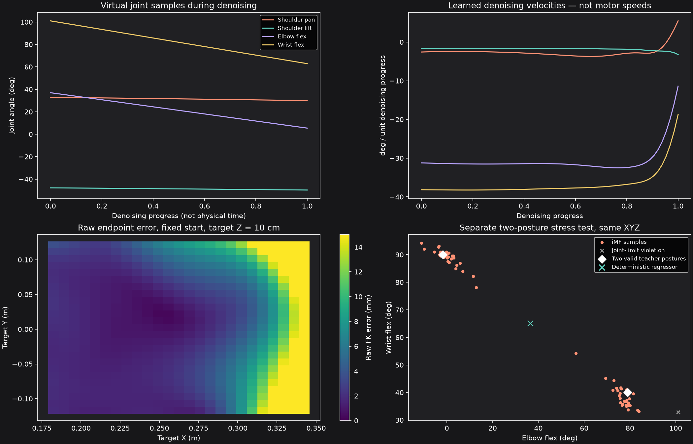

# What iMF contributes, and what it costs

An MLP is a multilayer perceptron: a nonlinear neural network of fully connected
layers. Both models in this project use MLP backbones. The comparison is between
two learning objectives, not “neural network versus flow.”

The supervised baseline takes the current angles and target XYZ and predicts one
set of joint-angle changes. Squared-error training favors the conditional mean.
The iMF model additionally takes a noisy action sample and two flow-time values,
and learns an interval-averaged velocity field. It can generate different outputs
from different noise samples. Both perform one network evaluation at deployment.

The original reaching dataset asks the numerical teacher for one nearby solution
per request. A deterministic regressor is well suited to that task. Its refined
median computation time was 3.22 ms versus 3.50 ms for iMF, so there is no evidence
that iMF is universally better here. Numerical IK alone took 10.21 ms. All of these
are offline model measurements; none demonstrates faster physical movement.

Papers such as [MP1](https://arxiv.org/abs/2507.10543) apply generative methods to
continuous, multimodal robot action distributions and compare them with other
generative policies. The benefit of [improved MeanFlow](https://arxiv.org/abs/2512.02012)
is efficient generation of a distribution, particularly compared with multi-step
generative sampling. A deterministic MLP already needs only one evaluation.

## A controlled utility demonstration without obstacles

We generated a separate dataset with two teacher solutions for each XYZ target:
wrist flex at 40° or 90°. Both solutions satisfy model joint ranges, endpoint IK
tolerance and sampled endpoint table clearance. This is not proof of a valid
full-arm trajectory or measured physical safety.

The data contain 428 training, 50 validation and 52 test rows, grouped by target.
The test rows represent 26 distinct held-out targets. Balanced paired labels are
kept together in their split. This deliberately constructed ambiguity test uses
the same start pose and a horizontal 10 cm target slice; it is not a natural
demonstration dataset or a new robotics benchmark.

With 64 iMF samples per held-out target, both requested posture modes were found
for every target. “Mode found” means at least one sample within 5° of the requested
wrist-flex angle, within joint bounds, and below 10 mm FK error. The deterministic
MLP's single prediction tended toward the middle posture and covered neither pair.

| Raw prediction metric | Deterministic MLP | iMF samples |
| --- | ---: | ---: |
| Median FK gap | 6.58 mm | 7.49 mm |
| Samples within joint limits and 2 mm | 0% | 3.85% |
| Samples within joint limits and 10 mm | 92.3% | 65.1% |
| Targets with both requested modes represented | 0% | 100% |

Thus iMF demonstrates **diversity**, not superior per-sample precision. All samples
still need validation/refinement. A mixture-density MLP or another probabilistic
model could also represent two modes; this is not a unique capability of iMF.

For distribution selection, validation uses the multivariate energy score rather
than squared error to one arbitrarily chosen label. The score assesses both fit
and spread; see [Gneiting and Raftery](https://sites.stat.washington.edu/raftery/Research/PDF/Gneiting2007jasa.pdf).
This statistical score is unrelated to electrical motor energy. The generative
training run became unstable later; inference uses the saved best-validation
checkpoint. This illustrates the additional tuning and checkpoint-selection cost.
The original reaching checkpoints were not replaced or deployed on hardware.

A useful next application would sample multiple validated/refined postures, then
choose by orientation preference, clearance, or estimated energy. Such a comparison
should include numerical IK with the same preference objective and a probabilistic
MLP baseline. We should not manufacture a claim that iMF always wins.

## Visualizations

[Open the standalone interactive report](flowreach-visualizations.html).
It includes joint-angle curves, learned velocity curves, a two-joint vector-field
slice, 3D virtual tip paths, selectable XYZ error-map slices, motor-power curves,
and the controlled multimodal example. The figure below is a static overview.



Generative velocity is change per unit **flow time**, not commanded rad/s or deg/s.
Virtual intermediates can violate physical limits and are never sent to motors.
The velocity curves evaluate the instantaneous field along finite-interval mapped
states; they need not exactly equal numerical derivatives of the separately
predicted average-flow path in an imperfect model.

The workspace maps hold the starting pose fixed and vary target X/Y at Z = 6, 10
or 14 cm. These are slices through a higher-dimensional conditional function, not
the entire action space. Colors saturate at 15 mm; interactive hover reports the
actual error. Blank cells violate selection, model coverage, or joint constraints.
Maps mix previously sampled and new locations; quantitative test scores use only
the held-out datasets. They are not full-path reachability certificates.

## Motor power and energy estimates

Power is a rate in watts; energy per completed reach in joules or Wh is the more
useful total-use metric. The evaluator reports total mean/peak W, total J/Wh,
per-joint energy and power curves. It sums five powered arm motors; the gripper
motor is off, but the closed jaw's mass remains in the URDF model.

The quasi-static model derives gravity torque from the derivative of URDF
gravitational potential. It estimates coil current as |torque|/Kt, copper loss
as R×current², and adds electronics idle power, speed-dependent running loss, and
positive mechanical power divided by an assumed efficiency. This accounts for
holding power that a simple torque×velocity calculation would miss.

Parameters are a **scenario**, not an identified model of these exact motors:

| Parameter | Assumption |
| --- | --- |
| Supply | 5.4 V, last observed rail voltage; not a new measurement |
| Shaft torque constant | 7.8 kg·cm/A = 0.765 N·m/A |
| Winding resistance | 2.5 Ω |
| Idle electronics current | 6 mA per powered servo |
| No-load running current | 150 mA at the published 7.4 V reference |
| No-load speed | 60° / 0.192 s at the published 7.4 V reference |
| Mechanical efficiency | 60%, unmeasured |
| Payload | 0 kg |

The electrical reference values come from [Waveshare's 7.4 V specifications](https://docs.waveshare.com/ST3215_Servo)
and [DFRobot's published servo specifications](https://www.dfrobot.com/product-2961.html).
Using nominal 7.4 V reference parameters in a 5.4 V scenario introduces further
uncertainty. URDF masses, friction, internal PWM behavior and actual efficiency
have not been identified. Inertial/Coriolis effects and post-reach holding are
excluded, as are controller, camera and computer power. No regenerative credit
is assumed. The value is not a measured wall-plug or supply-side power reading.

Across 79 matched valid requests, numerical IK, MLP+IK and iMF+IK all estimate
approximately **4.67 J per reach, 1.05 W mean, and 1.20 W peak** (medians of
per-reach metrics), because their
refined trajectories are almost identical. Tiny numerical differences are far
below model uncertainty and should not be ranked as efficiency improvements.
See [aggregate energy results](results/flowreach-energy.json).

Real electrical validation needs trusted current telemetry or a supply-side power
meter. No motors were connected, powered, enabled, or moved for this analysis.

## Reproduce

Install `.[flow,viz]`, then run these offline commands from the repo root:

```powershell
python -m deskbuddy.learned.energy_comparison --folder runs/flowreach --voltage 5.4
python -m deskbuddy.learned.multimodal_data --folder runs/flowreach/multimodal
python -m deskbuddy.learned.train --folder runs/flowreach/multimodal --steps 15000 --batch 512 --width 128 --validation-score energy
python -m deskbuddy.learned.multimodal_evaluate --folder runs/flowreach/multimodal
python -m deskbuddy.learned.visualize --folder runs/flowreach --output docs/research/flowreach-visualizations.html
```

The persistent operator hardware lock remains active. The root experiment folder
shares a 10 GB budget across nested datasets/checkpoints; CPU/GPU allocations in
these small experiments remained well below the requested memory limit.
