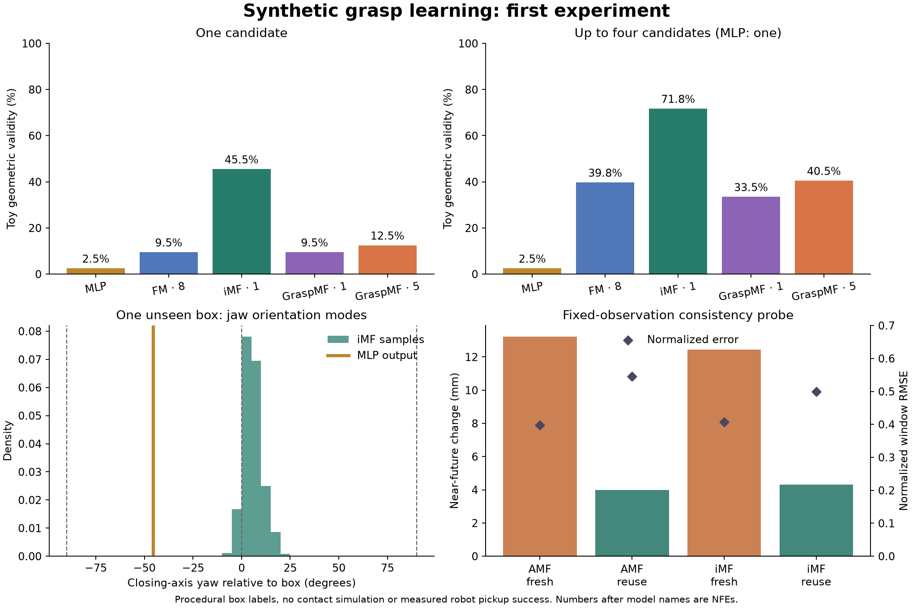

# MLP / iMF formulation audit

This describes the actual code and checkpoints, not the performance claimed by a
paper. The active UI still uses the older XY trajectory models. The disappointing
table in `learning-grasps-and-generalization.md` evaluates a separate, newer
joint-space experiment; those checkpoints were not deployed.

## What the models see and predict

| | Active XY models | New full-arm experiment |
|---|---|---|
| Context | 18 numbers | 67 numbers |
| Robot start | Tip XY only | Five joint angles |
| Goal | Tip XY only | Five joint angles, already chosen numerically |
| Obstacles | Two circle/rectangle slots, 2D | Six 3D axis-aligned box slots |
| Other geometry | XY bounds / tool clearance | Workspace XYZ bounds, table plane, wrist-lock mask |
| Output | 30 interior XY residuals = 60 numbers | 30 interior five-joint residuals = 150 numbers |
| Camera pixels / images | None | None |
| Gripper opening, contact, keys | None | None |

The 67 components are: start/goal joints 10, workspace lower/upper XYZ 6, unit
table normal plus plane offset 4, six boxes × (present bit, center XYZ, half-size
XYZ) 42, and five joint-lock bits. Joints are scaled using the actual robot limits;
positions are scaled by 0.5 m. The robot's dimensions are not scaled. Obstacle
slots are sorted by their lower world coordinates, not encoded as a point cloud
or by a permutation-invariant attention network.

For each teacher trajectory q[k], k=0…31, form the straight joint interpolation
L[k] between its start and goal. The training target is the flattened interior
residual `(q[k] - L[k]) / (joint_upper - joint_lower)`. Start/end are never predicted.
Train-split mean/std normalization is then applied to context and target; every
standard-deviation component is floored at 0.05. Decode reverses both operations
and restores the exact endpoint angles. Locked wrist roll is imposed at evaluation.
All angles here are radians. There is no claim that a raw decoded path is valid.

## MLP

Both baselines actually use MLP (fully connected) network backbones. The UI label
"MLP" means deterministic supervised regression; "iMF" means a noise-conditioned
MLP trained with the improved MeanFlow objective. Architecture and learning
formulation are separate choices.

The direct regression baseline is a fully connected network with three hidden
layers, width 192, SiLU activations and a linear output. For the full-arm run it
maps `R^67 → R^150` and has 116,118 parameters. It minimizes mean squared error
between its normalized output and the teacher residual. There is no random input,
so the same context always produces the same path. Four samples cannot improve it.

If two teachers go around an obstruction in different ways, MSE can favor an
average between those paths—even when the average collides. This is a limitation
of this deterministic baseline, not a reason it must lose every benchmark. Many
easy examples are almost straight, which makes regression a strong baseline here.

## FM and iMF

Both use a width-192 dense network on `[context, noisy trajectory, r, t]` and output
150 components (145,302 parameters). `Field.forward` parameterizes average velocity
as `u_theta(z,r,t,c) = z + network([c,z,r,t])`. The skip connection is a modeling
choice: subtracting this at one-step sampling initially favors a small residual,
i.e. a nearly straight joint path. This deserves an explicit ablation.

Let x be the normalized teacher residual and e an independent standard Gaussian.
Our convention is **data at time 0; noise at time 1**:

```
z_t = (1-t) x + t e
v_cond = e - x
```

FM regresses `u_theta(z_t,t,t,c)` onto `v_cond` with MSE. At inference it starts from
Gaussian noise and takes eight explicit Euler steps toward time zero. This is
eight network evaluations per candidate, not eight motor steps.

For iMF, the diagonal prediction supplies the instantaneous-velocity estimate:

```
v_hat = stopgrad(u_theta(z_t,t,t,c))
dudt = JVP(u_theta, inputs=(z_t,r,t), tangents=(v_hat,0,1))
V_hat = u_theta(z_t,r,t,c) + (t-r) stopgrad(dudt)
error = V_hat - (e-x)
```

This is a derivative in **generative noise time**, not joint velocity in degrees
per second. The JVP differentiates with respect to the input trajectory and time.
It does not send gradients or commands to the robot. The stop-gradients keep the
derivative term from introducing higher-order parameter gradients.

The core sign, diagonal tangent and stopped JVP match Algorithm 1 of
[Improved Mean Flows](https://arxiv.org/html/2512.02012). Our model is a compact
adaptation: it omits that paper's image-model architecture and guidance machinery.
That paper establishes generative image results; it does not establish superiority
on this arm or on obstacle routing.

iMF's training metric uses per-example squared error E, with detached weight
`w = (E + 0.001)^(-1)` in this run. The reported objective `mean(w*E)` naturally
stays near one over a wide range of raw errors. **Its value cannot be compared with
MLP MSE or interpreted as millimetres.** Raw residual MSE and actual geometric
validity are more useful debugging metrics.

At inference, one evaluation produces `x_hat = e - u_theta(e,0,1,c)`. A four-candidate
request supplies four different noise samples in a batch; numerical checks select
a valid result if any. Flow has capacity to represent multiple route modes,
but that capacity is not evidence that this trained network learned them.

## Exact training procedure for the disappointing table

- One shared dataset: 3,643 trajectories, 2,898 train / 373 validation / 372 test.
  Families and all their queries/teacher seeds stay together in one split.
- All three methods receive the same minibatch row IDs, normalization, batch 256,
  width 192 and 10,000 updates. Random noise/time draws differ by method.
- AdamW, weight decay 1e-5, gradient norm clip 5, initial learning rate 0.0003,
  cosine decay toward 10% of that rate; seed 20261125. No EMA or geometry loss.
- Draw two uniform times and sort them so r≤t. The first 1,000 updates use r=t;
  afterward 75% of examples still use r=t, with 25% off-diagonal intervals.
- An optional separate instantaneous-velocity head exists, but **was disabled**.
- Every 500 steps, two fixed independent draws score the validation distribution:
  `mean((||a-y|| + ||b-y|| - ||a-b||)/2)`. FM uses eight evaluations, iMF one.
  Save the checkpoint with the lowest validation energy score, not necessarily
  the final update. It is not selected by collision success.
- CPU-held-out testing then independently checks joint limits, locked joints,
  full-arm object capsules, self collision, workspace and table-body distances.

## What looks wrong, and what is not yet proven wrong

The core iMF v-loss is consistent with the cited pseudocode; I found no sign or
teacher-tangent substitution bug in that core. That is not a complete proof of
training correctness. The experiment still has substantial weaknesses:

1. Only 250 layouts support a difficult 67-dimensional conditional problem.
   Failed teacher generation also underrepresents difficult layouts.
2. Long, 150-dimensional flattened outputs have little temporal inductive bias.
   Full joint winding and workspace geometry are much harder than XY sketches.
3. MSE/energy-score training and selection do not optimize collision success.
   The available differentiable body loss was not used in this run.
4. Straight-path examples and the residual skip parameterization encourage a
   nearly straight result; iMF solved none of the 31 blocked test cases.
5. Diagonal-heavy uniform interval sampling, architecture capacity, target
   normalization floors and 1/4/8 inference-step budgets need ablation.
6. These are geometric paths, with no RGB observation, contact, dynamics or
   grasp-success labels. They cannot explain intelligent gripping behavior.

The result is therefore evidence against **our current setup**, not against iMF
in general. Nor do the papers justify claiming iMF must beat an MLP on this task.
For gripping, the next experiment separates grasp-pose generation from a reactive
approach/close/lift policy, rather than reusing this path network as a grasper.

## Paper-inspired grasp experiment

[Fast Generative Grasping via Lie Group-Constrained MeanFlow](https://arxiv.org/html/2608.26076v1)
models a distribution over translation and rotation, using a conditional-flow
anchor plus flow-map composition consistency. Its GraspMF is not identical to
our iMF v-loss. The transferable idea here is fast alternative grasp poses that
remain rotations, followed by robot-specific reachability checks. A box-only
geometric experiment is not a reproduction of its ACRONYM contact benchmark.

[Adaptive Mean Flow](https://arxiv.org/html/2610.06089v1) uses action-wise noise
levels and reuses the shifted previous prediction: near-future actions change
little while more distant actions can change more. Our adaptation uses this
for short-horizon geometric pickup sequences. Its benefit must be tested under
target perturbations against fresh-noise replanning, not assumed from a smooth
plot. It remains distinct from physical grasp success.

Synthetic small boxes can supply pose candidates and approach/close/lift labels.
Those labels encode the teacher's geometry; they do not create friction, thin-key
contacts, chain entanglement, compliance or visual success evidence. Evaluate on
unseen box sizes/layouts first, then collect real key demonstrations and failures.
Do not claim box-to-key transfer until measured on the physical arm.

## Implemented box experiments and first results

Both experiments are offline research programs: neither imports a motor interface
nor replaces the live grasp controller. They use geometric teachers, not successful
physical demonstrations. Run them with the project virtual environment:

```powershell
python -m deskbuddy.learned.grasp_lab --help
python -m deskbuddy.learned.adaptive_grasp --help
python -m deskbuddy.learned.grasp_lab --folder runs/flowreach/box-grasps-v1 --evaluate
python scripts/visualize_grasp_lab.py
```

### Grasp-pose distribution

`learned/grasp_lab.py` generates 2,000 boxes with two face-aligned grasp modes
each. Box width/depth vary from 12–40 mm and height from 8–35 mm. Entire object
IDs are split between training and held-out evaluation; modes of the same object
are not split across those sets.

Input is five numbers: three box dimensions divided by 50 mm, cos(2 yaw), and
sin(2 yaw). Output is eight numbers: object-relative grasp-center XYZ divided by
50 mm, a unit quaternion (scalar first), and opening divided by 50 mm. This is
**a generic grasp-center frame, not the SO-101 fixed-jaw TCP**. Before live use,
opening-dependent gripper geometry must convert that frame into the calibrated
robot TCP; no such motor adapter is enabled here.

MLP regresses the eight target values. FM and iMF condition on the same box
features plus a noisy pose and time, and use their respective velocity objectives.
The separate GraspMF-inspired model predicts an endpoint on translation × rotation:
rotations are advanced using quaternion exponential/log maps. Its loss combines
a conditional-flow anchor with 0.2 times a flow-composition consistency loss.
It is a dense geometric adaptation, without the paper's point-cloud encoder,
contact labels or physics evaluation. All models use width 128, 5,000 updates,
batch 256, AdamW at 3e-4 and gradient clipping at 5. Training took about 67 seconds
on the RTX 5070. Frozen evaluation uses seed 1739 and 200 unseen objects.

| Model | Network evaluations | First candidate valid | At least one of four valid |
|---|---:|---:|---:|
| MLP | 1 | 2.5% | 2.5% (one deterministic output) |
| FM | 8 | 9.5% | 39.8% |
| iMF | 1 | 45.5% | 71.8% |
| GraspMF adaptation | 1 | 9.5% | 33.5% |
| GraspMF adaptation | 5 | 12.5% | 40.5% |

Validity here means center XY error below 3 mm, center height between 25–85%
of box height, a downward tool axis within 12 degrees, closing axis within 12
degrees of a box face, and opening 2–12 mm wider than the required dimension.
It does **not** measure contact stability or pickup success. The low deterministic
MLP score exposes the deliberately ambiguous two-mode labels: its average can
point between two valid jaw orientations. A mixture-output MLP is a stronger
next baseline. Multiple random seeds and stronger baselines are still needed.
The GraspMF adaptation is currently worse than iMF here; its paper does not
promise that this simplified implementation will win.

### Adaptive short-horizon pickup

`learned/adaptive_grasp.py` builds 6,000 windows from 1,000 procedural boxes and
two grasp modes. A 48-step teacher approaches, descends, closes and lifts; training
uses 16-step windows and holds out whole object IDs. Each action contains local
XYZ/50 mm, cos(yaw), sin(yaw), and opening/50 mm. The 17-dimensional context is
five box features plus current and previous six-dimensional actions. The network
outputs 16 × 6 action velocities and receives a separate time interval per action.

Matched Adaptive-MF and Adaptive-iMF models use a width-192 dense network, 5,000
updates, batch 256, AdamW 3e-4 and clipping at 5. Training mixes independent and
ordered action-wise noise levels, with 50% diagonal intervals. Replanning shifts
the previous window by two steps, repeats its tail, and increases fresh noise
from 0.08 near the present to 0.85 at the far horizon. MF uses the teacher tangent
for its JVP; iMF uses its own diagonal velocity prediction. Training took 32 seconds.

| Fixed-observation probe | Fresh-noise change | Reused-plan change | RMSE fresh → reused |
|---|---:|---:|---:|
| Adaptive MF | 13.23 mm | 3.98 mm | 0.398 → 0.546 |
| Adaptive iMF | 12.46 mm | 4.31 mm | 0.408 → 0.500 |

Reuse reduced near-future jitter, but increased normalized teacher error. This is
not yet a robust closed-loop improvement: a frozen wrong plan can also be smooth.
The next experiment must perturb target pose and observation timing, measuring
tracking error and recovery as well as smoothness. No physical grasp was tested.



### Checks and remaining route to keys

`tests/test_imf_identity.py` checks the iMF sign, time convention, JVP identity
and one-step sampling against an analytic Gaussian flow. Other tests exercise
quaternion endpoints, finite training gradients, teacher geometry and adaptive
replanning. These checks can catch formulation bugs; they cannot establish that
a trained model approximates the true field well.

Next add a robot-specific grasp-center-to-TCP adapter, numerical orientation IK,
whole-arm collision validation, and perturbation/contact simulation. Then collect
real key/chain trials and visual success labels. Box-only labels do not represent
thin key contact, chain tangles, friction, or camera uncertainty. Keep these
checkpoints out of the live motor policy until those gaps are measured.


## Can profile and executable adapter

The can-specific run is separate from the small-box checkpoints. It uses 1,500
procedural cylinders (60–74 mm diameter, 105–145 mm height), four random jaw-yaw
labels per cylinder, whole-cylinder splits, 6,000 examples, and 5,000 matched
updates per model. Context is [diameter, diameter, height]/50 mm plus [1,0]; a
cylinder has no privileged table yaw. The output remains normalized XYZ, a unit
quaternion and opening. Geometric validation therefore does not require alignment
with a rectangular box face. First-draw held-out validity was MLP 100%, FM 99.5%,
iMF 98.5% and GraspMF-adaptation 82.5%. These are simple procedural-label checks,
not physical pickup rates. They do not establish an iMF advantage over regression.

Can mode uses a nominal URDF fixed-jaw-to-opening-center transform. The analytic
baseline chooses a cylinder grasp; iMF samples 32 object-relative candidates,
checks up to three with numerical IK and full route validation, then selects the
shortest executable route among those checked. This is automatic selection, not
operator-entered box dimensions. Closure is near a width-derived percentage;
no learned contact-force controller or physical success predictor was trained.

A mock 66 × 122 mm can scene produced complete baseline and iMF routes without
hardware access. iMF preflight took about 9 seconds versus about 2.5 seconds for
the analytic baseline in that case; candidate IK/validation dominates, not the
one-evaluation neural sample. Joint speed uses the same 24 degrees/s default.
Any physical benefit must be measured, not inferred from the validity numbers.
