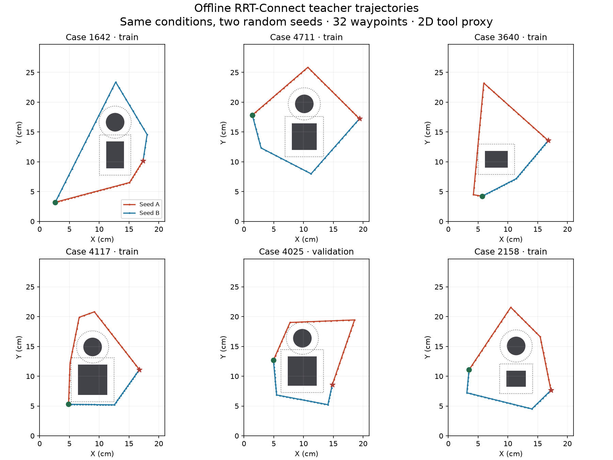

# Offline Cartesian trajectory baseline

The first new DeskBuddy milestone is implemented independently of the live robot:
continuous circle/rectangle segment checks, tool-radius and margin inflation,
bidirectional RRT-Connect, collision-checked shortcutting, and 32-point resampling
that preserves all corners. Resampled float32 paths are validated again before
being admitted as training rows. Shortcutting removes detours; it does not make
piecewise-linear corners differentiably smooth.

The initial run generated 5,000 scenarios, with two route seeds per identical
start/goal/obstacle condition, producing 10,000 valid paths. Of the direct
start-to-goal segments, 52.68% intersected inflated obstacles. All teacher attempts
succeeded on these simple layouts; this is not a learned-model result or a hard
motion-planning benchmark. Failure cases remain represented in the report schema.

Median generation time was 0.92 ms and median generation-plus-validation time was
1.21 ms on this machine. This excludes scene creation, metrics, file I/O,
perception, IK and actuation. It is not an end-to-end robot timing result.

There are 8,000 train, 1,000 validation and 1,000 test paths. All start/goal cases
from a given obstacle-layout family, and both route seeds for each condition, stay
in the same split. The run has 160/20/20 disjoint layout families. This grouping
prevents identical-layout leakage; it does not guarantee spatial separation of
similar layouts across independently sampled families.



The figure selects six large route differences from distinct layout families to
illustrate alternatives; it is not a representative random sample. Solid obstacles
are physical proxies, dotted outlines include tool radius plus margin, and path
dots are the 32 waypoints. These paths have no joint lifting, time parameterization
or full-arm collision check and must not be sent directly to the robot.

Reproduce from the repository root with `.[viz,dev]` installed:

```powershell
python -m deskbuddy.trajectory.dataset --folder runs/deskbuddy/trajectories-v1 --scenarios 5000 --routes 2
python -m deskbuddy.trajectory.visualize --folder runs/deskbuddy/trajectories-v1
```

Use a new folder for another run; the generator refuses to overwrite an existing
dataset. Nested experiments share the existing 10 GB budget. The generated local
data live under `runs/deskbuddy/trajectories-v1/`; only the compact [metrics](results/trajectory-baseline.json)
and figure are published in docs. MLP/FM/MeanFlow/iMF **trajectory** models have
now been [trained and benchmarked](trajectory-learning.md) on this common dataset.
They remain separate from the live endpoint-IK controller.
