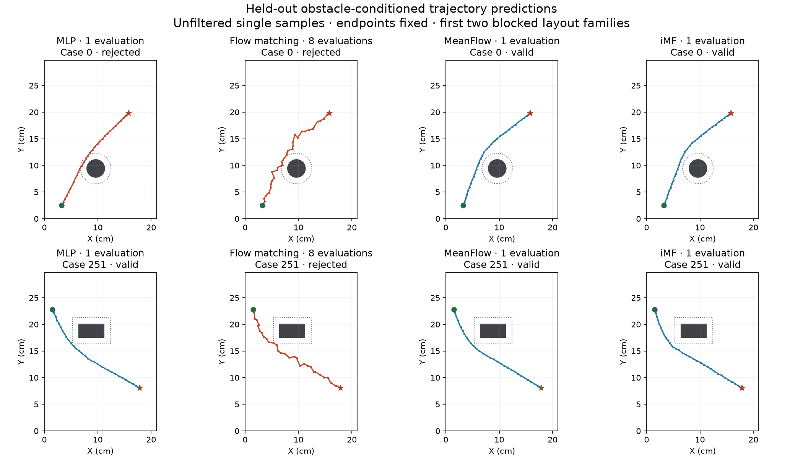

# Obstacle-conditioned trajectory learning

This is a separate offline trajectory experiment, not the live Flow + IK endpoint model. Four models predict all 30 interior XY waypoints; start and goal are fixed exactly. The input contains start, goal, up to two obstacles and tool/margin inflation. Normalized circle radii retain both axis scales; all validation happens after returning to physical metres.

## Held-out comparison

| Method | NFE / candidate | Candidates | Raw valid | Blocked-case valid | RRT fallback | Median total ms | P95 total ms |
|---|---:|---:|---:|---:|---:|---:|---:|
| RRT | 0 | 1 | 100.0% | 100.0% | 0.0% | 1.18 | 4.49 |
| MLP | 1 | 1 | 69.2% | 37.6% | 30.8% | 0.84 | 5.46 |
| FM | 1 | 1 | 69.8% | 39.6% | 30.2% | 0.67 | 3.86 |
| FM | 4 | 1 | 74.0% | 49.0% | 26.0% | 0.67 | 3.58 |
| FM | 8 | 1 | 73.4% | 47.8% | 26.6% | 0.85 | 3.83 |
| FM | 16 | 1 | 73.2% | 47.3% | 26.8% | 1.18 | 4.46 |
| MF | 1 | 1 | 81.8% | 62.9% | 18.2% | 0.54 | 3.40 |
| MF | 4 | 1 | 67.4% | 39.6% | 32.6% | 0.75 | 4.04 |
| IMF | 1 | 1 | 86.2% | 72.7% | 13.8% | 0.53 | 3.13 |
| IMF | 4 | 1 | 69.4% | 44.5% | 30.6% | 0.70 | 3.66 |
| FM | 8 | 4 | 93.2% | 86.1% | 6.8% | 1.85 | 3.53 |
| MF | 1 | 4 | 97.0% | 93.9% | 3.0% | 1.54 | 2.62 |
| IMF | 1 | 4 | 97.6% | 95.1% | 2.4% | 1.60 | 2.93 |

Each row uses the same 500 held-out conditions. Total time includes neural preprocessing/generation/decoding, continuous segment validation, and RRT fallback when all candidates are invalid. It excludes perception and robot execution. Raw validity is before fallback. K=4 batches four candidate trajectories, then selects the shortest valid one; this costs K times the candidate NFEs and additional checking. It is not a free one-sample improvement.



## Training and limitations

The experiment uses 8,000 training and 1,000 validation paths; all layout families and route seeds stay in their assigned split. Networks have three 192-unit hidden layers. The conditional MLP has 89,340 parameters; each flow generator has 101,244 inference parameters. iMF adds a separate supervised instantaneous-velocity network during training, bringing its training parameter count to 202,296; that network is not called during sampling.

The final run used 20,000 steps on an RTX 5070, with peak allocated tensor memory 54.5 MB. MF/iMF use detached adaptive weighting (p=0.5), 25% diagonal examples after a 1,000-step diagonal warm-up, and the same cosine learning-rate schedule starting at 0.0003. Checkpoints were selected using validation distribution energy score, a statistical score unrelated to motor electrical energy. These are engineering adaptations, not reproductions of the papers' image-generation recipes.

The initial plain-L2 run had severe iMF divergence; the second adaptive-p=1 run was stable but weak. Both histories and checkpoints are preserved under models-v1 and models-v2. The reported models-v3 run uses p=0.5 and the iMF auxiliary velocity head. Comparisons between these runs confound multiple recipe changes and are not controlled ablations. No universal iMF advantage is claimed.

The MeanFlow objective follows [Geng et al., Algorithm 1](https://arxiv.org/html/2505.13447v1). iMF uses the predicted-velocity JVP formulation and optional auxiliary head described in [Geng et al., Algorithm 1 and Appendix A](https://arxiv.org/html/2512.02012v2). Standard FM uses instantaneous-velocity regression with Euler sampling; MF/iMF use interval-average updates. MF and iMF have genuinely different training tangents.

The proxy benchmark is distinct from hardware execution. The live controller lifts selected trajectories into numerical IK, validates whole-arm geometry and can replan from current feedback when scene geometry changes. The [full-arm experiment](learning-grasps-and-generalization.md) is the harder transfer test; its 0/31 blocked-case result motivates whole-body conditioning.

## Reproduce

```bash
python scripts/build_planner_comparison.py --reproduce
```

See the [reproduction guide](reproducibility.md) for the released inputs, seeds and fresh training commands.

Training refuses to overwrite checkpoints: use a new output directory for a new run. [Structured metrics](results/trajectory-learning.json) include all timing components and checkpoint steps.
